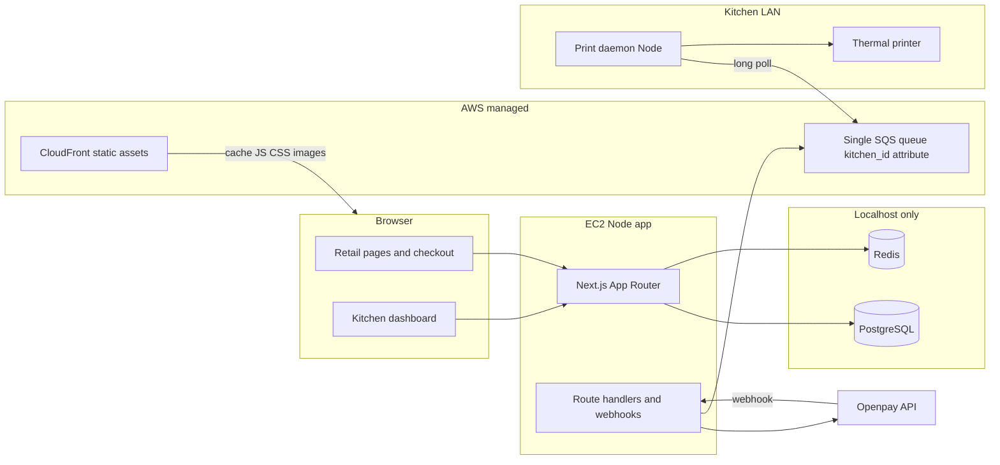
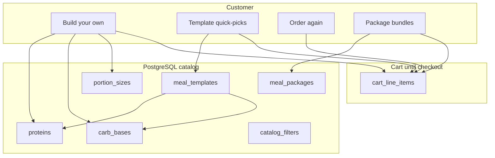
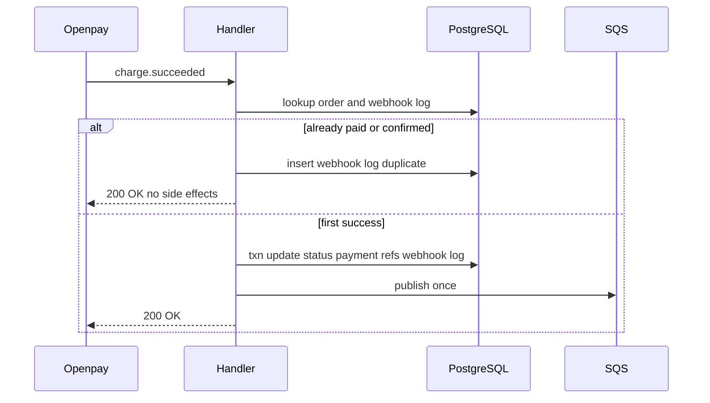
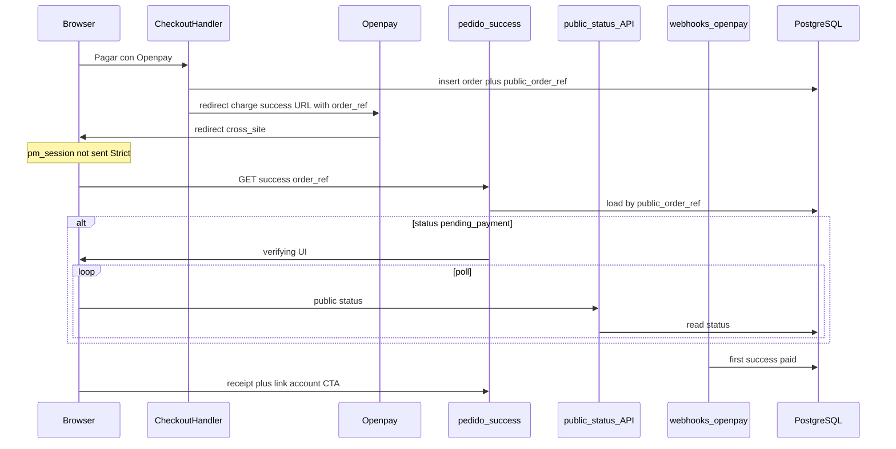
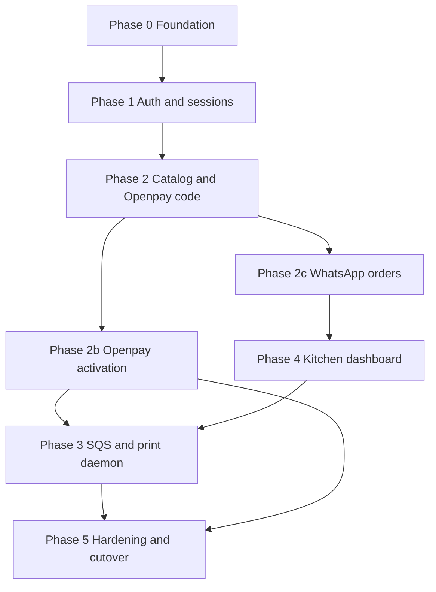

# Power Meals retail platform — phased implementation plan

Phased upgrade from static WhatsApp ordering to a Node-hosted Next.js app on EC2 with PostgreSQL, Redis sessions, Openpay checkout, SQS kitchen dispatch, per-facility print daemons, and a staff dashboard—preserving the existing brand UI and MapLibre patterns where possible.

Related: [power-meals-v2.md](./power-meals-v2.md) (engineering brief), [power-meals.md](./power-meals.md) (current product context).

## Implementation checklist

- [x] **Phase 0:** Drop static export, systemd + EC2/Nginx, PostgreSQL + Redis, Drizzle schema/migrate + seed from `lib/*-data.ts`
- [x] **Phase 1:** Redis sessions, Argon2id + pepper, auth rate limits, `/cuenta` `/historial`, kitchen role
  - [x] 24h sliding TTL on `session:*` and `cart:session:*`; `REDIS_SESSION_TTL_SECONDS=86400`
  - [x] Guest cart in Redis; `lib/cart/` helpers for touch + migration prep
- [x] **Phase 2:** DB-backed catalog/cart, Openpay checkout + webhook, guest post-payment account linking (code complete; Openpay stays off until [Phase 2b](#phase-2b--openpay-activation-deferred))
  - [x] **Catalog migration (see [Catalog and ordering model](#catalog-and-ordering-model)):** meal builder + templates + packages; retail categories (4 filters); seed from Sistema Maestro xlsx—not inventory ingredients
  - [x] **Packages UI:** POWER Chicken / POWER Mix on [`app/page.tsx`](./app/page.tsx) (home) and [`app/menu/page.tsx`](./app/menu/page.tsx)
  - [x] **Pedido UX:** build-your-own plate, template quick-picks, reorder from past orders (logged-in)
  - [x] Strict webhook idempotency + `openpay_webhook_events`; no duplicate SQS on replay (the SQS publish itself lands in Phase 3 behind the same first-success gate)
  - [x] `public_order_ref` + Openpay redirect URL with `order_ref` (Openpay takes one URL; cancel is reached from it)
  - [x] Sessionless `/pedido/success` + `/pedido/cancel` + public status polling API
  - [x] Post-payment **“Crea una cuenta para guardar este pedido”** + attach order to user
  - [x] Migrate guest cart → cart on login/link; clear cart on first paid webhook
  - [x] **Copy while Openpay is off:** home, `/menu`, footer, and `/pedido` follow `isOpenpayConfigured()` and describe WhatsApp + transferencia; they do not promise card payment
- [ ] **Phase 2b — Openpay activation (deferred):** sandbox merchant id + private key, webhook user/password, one real sandbox payment, then restore the card-payment copy (see [Phase 2b](#phase-2b--openpay-activation-deferred))
- [x] **Phase 2c — WhatsApp order ingestion:** store the order only for a logged-in user, or when that guest logs in afterward; status `ordered_whatsapp`, never `paid` (see [Phase 2c](#phase-2c--whatsapp-order-ingestion))
- [x] **Phase 3:** Single SQS queue + `kitchen_facility_id` attributes, print-daemon filter per LAN facility (see [Phase 3 status](#phase-3--kitchen-dispatch-sqs--receipt-contract))
  - [x] Print failures: no delete, `ChangeMessageVisibility` backoff (60–300s), non-blocking poll loop
- [x] **Phase 4:** `/kitchen/dashboard` with 10s polling, facility-scoped orders and status lifecycle (see [Phase 4 status](#phase-4--kitchen-staff-dashboard))
- [ ] **Phase 5:** Openpay prod toggle (after Phase 2b) + powermeals.mx webhook, EC2 stability gate, sunset Cloudflare static

---

## Context and starting point

Today the app is a **static export** ([`next.config.ts`](./next.config.ts): `output: "export"`) deployed via Wrangler/Cloudflare. Catalog and zones live in [`lib/menu-data.ts`](./lib/menu-data.ts) and [`lib/locations-data.ts`](./lib/locations-data.ts). Checkout is [`components/OrderForm.tsx`](./components/OrderForm.tsx) → WhatsApp deep link ([`lib/whatsapp.ts`](./lib/whatsapp.ts)).

v2 target ([`power-meals-v2.md`](./power-meals-v2.md)): full Node server on **EC2 + Nginx**, **PostgreSQL** and **Redis** on localhost, **Openpay**, **Redis-backed sessions**, **SQS** after paid orders, **kitchen dashboard**, **per-kitchen LAN print daemon**. Checkout: **guest first, optional account link after payment**.



---

## Decisions locked in

| Area | Choice |
|------|--------|
| Payments | **Openpay** hosted flow; no PAN/CVV on EC2; store charge id, status, amounts only |
| Checkout identity | **Guest checkout**; post-payment **“create account to save this order”** (email + password) linking `orders.guest_email` / session to `users.id` |
| Print path | **One daemon per kitchen facility** on a local PC; polls **shared** SQS queue, filters by `kitchen_facility_id` attribute, prints ESC/POS |
| Sessions | Redis cookie session id; `HttpOnly`, `Secure`, `SameSite=Strict` (intentional for CSRF; Openpay return uses [public `order_ref`](#openpay-redirect-return-samesitestrict), not session on first paint) |
| Openpay return | **`SameSite=Strict` unchanged**; success/cancel pages load by query param **`order_ref`** (`orders.public_order_ref`); **never** require session cookie on first paint after redirect from Openpay |
| Passwords | Argon2id + per-user salt + env **pepper** |
| Hosting | EC2 Node (`next start`); **systemd** unit for app; Nginx reverse proxy; CloudFront for static edge cache |
| Data layer | **Drizzle ORM** + versioned migrations in repo (`drizzle/`); optional `schema.sql` snapshot for ops |
| Openpay UX | **Redirect checkout** (hosted payment page); webhook confirms payment; sandbox → prod keys in env |
| SQS | **Single queue**; `MessageAttributes.kitchen_facility_id` on publish; each LAN daemon long-polls same queue and **skips/deletes only messages matching its facility** |
| Kitchen dashboard | **10-second client polling** to refresh order list (no SSE/WebSockets in v1) |
| Checkout UX | **Openpay primary** when configured (pay CTA); secondary text button **“¿Prefieres pagar por WhatsApp?”** reuses [`lib/whatsapp.ts`](./lib/whatsapp.ts) prefilled `wa.me` link (transfer flow, no card). **Until Openpay is connected, WhatsApp is the only checkout** and the pay button stays hidden |
| Openpay rollout | Integration **stays in the repo and stays off** until Phase 2b. No merchant id / private key means `isOpenpayConfigured()` is false: `/pedido` hides the card button, `POST /api/checkout` returns 503, and the webhook refuses to mark anything paid |
| WhatsApp orders | A WhatsApp checkout is stored **only with a `user_id`**: immediately if the customer is logged in, or on the later login/register from the same browser session. Status is **`ordered_whatsapp`**, not `paid`. Guests who never log in leave no `orders` row |
| Deploy | **Sunset Cloudflare static** ([`wrangler.jsonc`](./wrangler.jsonc)) after EC2 Node app is live, stable, and DNS cut over; archive steps in `docs/legacy-static-deploy.md` |
| Openpay config | Env-driven **sandbox vs production** toggle (see below); production webhook registered in Openpay dashboard |
| Webhook idempotency | **Strict state gate:** if order already `paid`/`confirmed`, log duplicate and **200 OK** with no SQS or status side effects; audit in **`openpay_webhook_events`** |
| Session / cart memory | **24h sliding TTL** on anonymous sessions and guest carts in Redis; logged-in working cart in PostgreSQL until checkout completes—**not** a long-term saved cart |
| Retail catalog | **Meal builder** (protein + carb base + size + style)—**not** inventory ingredients; **templates** (19 named combos) + **packages** (POWER Chicken / POWER Mix); prices from Sistema Maestro V1 |
| Menu filters (customer) | **High protein**, **High carb**, **Low calories**, **Vegetarian** (Spanish UI labels; see [Catalog and ordering model](#catalog-and-ordering-model)) |
| Packages merchandising | Show package products on **home** and **`/menu`**; deep-link into `/pedido` with package preselected |

## Catalog and ordering model

**Question:** Does “build your own plate” require storing **inventory ingredients** (insumos) instead of **dishes**?

**Answer: No—for the retail site.** Inventory ingredients (purchase units, yields, supplier SKUs in the ops workbook) stay **back-office** and are out of scope for customer checkout. The storefront sells **configured meals**: pick a **protein**, **carb/base**, **portion size** (Regular / Plus), and **plate style** (Balanced = carb + veggies, or Double carb = 2× same carb, no veggies), plus optional **premium protein upgrades** priced per the maestro file. That matches the **38 sellable SKUs** in `02 Menú SKU` without exposing raw grams of chicken or rice as shopper-facing “ingredients.”

Kitchen and print still receive a **resolved line snapshot** (human-readable name, gramajes served, salsa rule, unit price)—same information density as today’s WhatsApp messages.

### Three ways to add a meal to the cart

| Path | Who | Source |
|------|-----|--------|
| **Build your own** | Everyone | Validated combination of builder options → price from rules (base tier + premium upgrade + size) |
| **Templates** | Everyone | Curated rows matching the 19 named platillos in Sistema Maestro (e.g. “Pollo + arroz + veggies”)—one tap fills the builder |
| **Order again** | Logged-in customers | Copy line composition from a previous **`order_line_items`** row (scoped to `user_id` via `/historial`) |

Guests do not get persistent “order again” until they create an account or link after payment; they can still use builder + templates.

### Retail categories (filters—not cost tiers)

Replace the placeholder four tabs (`proteina`, `balanceado`, `ligero`, `desayuno`) with **customer-facing filters**. A template or builder result may appear under **multiple** filters when tagged.

| Slug | English (plan) | Spanish UI (site) |
|------|----------------|-------------------|
| `alto-proteina` | High protein | Alto en proteína |
| `alto-carbohidrato` | High carb | Alto en carbohidrato |
| `bajas-calorias` | Low calories | Bajo en calorías |
| `vegetariano` | Vegetarian | Vegetariano |

**Tagging:** Seed rules from Sistema Maestro + ops review (e.g. ensalada / veggie-forward → vegetarian; pasta/camote/arroz-heavy → high carb; salad / lower portion targets → low calories; default protein meals → high protein). Tags are **merchandising**, not separate price lists. Commercial **Base vs Premium** protein tier (pollo vs arrachera vs salmón) remains on **proteins**, not on these four filters.

### Packages (commercial products)

From `05 Precios Paquetes`—sold as **bundle line items**, not as 6–15 separate dish rows:

| Product | Meal counts | Sizes | Example prices (MXN) |
|---------|-------------|-------|----------------------|
| POWER Chicken | 6 / 10 / 15 | Regular / Plus | e.g. 649 / 999 / 1499 (Regular) |
| POWER Mix | 6 / 10 / 15 | Regular / Plus | e.g. 749 / 1199 / 1699 (Regular) |

**UI:** Dedicated section on **home** and **`/menu`** (cards + CTA to `/pedido?paquete=…`). Checkout expands a package into **N meal slots** (customer fills each slot via builder or template) or a simplified “chef’s mix” flow—implementation detail in Phase 2 UI; DB stores **`package_id`**, **`package_tier`**, and per-slot compositions.

### Pricing rules (from Sistema Maestro V1)

- **Individual base** (pollo / molida / basa / ensalada): Regular **$139**, Plus **$179** per meal.
- **Premium upgrades** (add to base price per meal): Asada +25/+35, Sirloin +35/+50, Arrachera +50/+75, Salmón +75/+110 (Regular / Plus).
- **Salsa:** 1 oz Roja or Verde included (store as line note / kitchen flag, not a priced modifier).
- Server **recomputes** totals at checkout; never trust client-submitted prices.

### Database changes (Phase 2 catalog migration)

Phase 0 shipped a simplified **`categories` + `dishes`** model for bootstrap seed. Phase 2 adds a **catalog migration** (`drizzle/0001_catalog_builder.sql` or similar) rather than modeling shopper-facing “ingredients.”

**Keep / extend**

| Table | Role |
|-------|------|
| `kitchen_facilities`, zones, pickup, payments, webhooks | Unchanged |
| `orders` | Add **`public_order_ref`** (unique, set at checkout); used for sessionless Openpay return |
| `order_items` | **Replace or supersede** with **`order_line_items`** that snapshot builder output (see below) |

**New or repurposed catalog tables**

| Table | Purpose |
|-------|---------|
| `catalog_filters` | The four retail filters (slug, Spanish label, sort order) |
| `proteins` | Sellable proteins: pollo, molida, basa, asada, sirloin, arrachera, salmón; `tier` (`base` \| `premium`); upgrade deltas Regular/Plus |
| `carb_bases` | Puré, camote, pasta, arroz, ensalada; flags for `allows_double_carb`, veggie pairing |
| `portion_sizes` | `regular`, `plus`; gramajes served (protein g, carb g, veg g, double-carb g) |
| `meal_templates` | Named quick-picks (19 platillos); FKs to protein + carb_base; optional default size/style; `sku_code` (SKU-01…SKU-38 mapping for ops) |
| `meal_template_filters` | M:N → `catalog_filters` |
| `meal_packages` | POWER Chicken / POWER Mix variants (meal count, size, price_cents, rules JSON) |
| `cart_line_items` | **Replaces `cart_lines` dish-only shape:** `user_id`, `quantity`, `source` (`builder` \| `template` \| `reorder` \| `package_slot`), composition FKs or jsonb, `unit_price_cents` cache, `updated_at` |
| `package_cart_lines` | Optional: package header in cart linking multiple slot lines |

**`order_line_items` (fulfillment snapshot)**

| Column | Purpose |
|--------|---------|
| `order_id`, `quantity` | Standard |
| `display_name` | Spanish label printed on receipt |
| `unit_price_cents`, `line_total_cents` | Frozen at order time |
| `protein_id`, `carb_base_id`, `portion_size`, `plate_style` | `balanced` \| `double_carb` |
| `protein_grams`, `carb_grams`, `veg_grams` | Served weights for kitchen |
| `salsa_note` | e.g. “1 oz Roja/Verde” |
| `template_id` | Nullable; set when added via template |
| `package_id` | Nullable; set when line belongs to a package bundle |

**Deprecate after migration:** `dishes` and legacy `categories` (or rename `categories` → `catalog_filters` in a single migration if simpler). Seed script: import from **Sistema Maestro** xlsx (`02 Menú SKU`, `05 Precios Paquetes`); retire placeholder [`lib/menu-data.ts`](./lib/menu-data.ts) for production paths.

**Reorder:** No extra table—query prior `order_line_items` joined to `orders` where `orders.user_id = session user` and status not cancelled; “Pedir de nuevo” clones composition into `cart_line_items`.



### Cart / Redis key update (Phase 1–2)

Guest Redis cart stores **serialized cart line payloads** (composition + qty), not `dish_id` maps. Logged-in users use **`cart_line_items`** in PostgreSQL with the same shape. Update [`lib/cart/`](#session-and-cart-memory) helpers accordingly when implementing Phase 2.

## `kitchen_facilities` (PostgreSQL + Drizzle)

Dedicated table for production kitchen / dispatch locations. Coordinates stored as `latitude` / `longitude` (decimal); map code can use `[longitude, latitude]` when interfacing with MapLibre.

| Column (conceptual) | Purpose |
|---------------------|---------|
| `id` | UUID or serial PK |
| `slug` | Stable key for SQS attributes, daemon env, staff scoping |
| `name` | Display name (Spanish labels as shown) |
| `latitude`, `longitude` | Facility pin |
| `is_active` | Soft-disable without deleting history |

**Seed rows (Phase 0 migration + seed script):**

| slug | name | latitude | longitude |
|------|------|----------|-----------|
| `zona-rio` | Zona Río | 32.52820512415235 | -117.01893541543576 |
| `otay` | Otay | 32.53809645350098 | -116.92983513766147 |
| `plaza-monarca` | Plaza Monarca | 32.500821014237935 | -116.92067276725912 |
| `rio-tijuana-3ra-etapa` | Rio Tijuana 3ra Etapa | 32.497178312977205 | -116.93127319919203 |

**Routing at checkout:** `delivery_zones.kitchen_facility_id` and `pickup_points.kitchen_facility_id` (NOT NULL FK). Seed from [`lib/locations-data.ts`](./lib/locations-data.ts): direct match where slugs align (`zona-rio` zone → `zona-rio` facility, `otay` zone → `otay` facility); remaining zones/points get an initial FK via seed rules documented in `scripts/seed-from-static-data.ts` (ops can reassign in DB without code deploy). `orders.kitchen_facility_id` is copied from the chosen zone or pickup point at order creation.

**Staff & print:** Kitchen users carry `users.kitchen_facility_id`; print daemon env `KITCHEN_FACILITY_ID` matches `kitchen_facilities.id` or slug per implementation convention.

## Openpay environment and webhooks

**Client module** (`lib/openpay/`): single factory reads env and selects API base URL:

- `OPENPAY_SANDBOX_MODE=true` → `https://sandbox-api.openpay.mx`
- `OPENPAY_SANDBOX_MODE=false` (or unset in prod) → `https://api.openpay.mx` (production)

**Required env vars:**

```bash
# Development (.env — chmod 600 on server)
OPENPAY_MERCHANT_ID=
OPENPAY_PRIVATE_KEY=
OPENPAY_SANDBOX_MODE=true

# Production (same keys, different values; flip sandbox flag)
OPENPAY_SANDBOX_MODE=false
```

Optional but recommended: `.env.example` in repo with empty values and comments; never commit real keys.

**Webhook endpoint (production):** Register in Openpay dashboard:

`https://powermeals.mx/api/webhooks/openpay`

**Handler behavior** (`POST /api/webhooks/openpay`):

- Verify Openpay signature / auth per their docs.
- Resolve `order_id` from payload (Openpay charge / order reference stored when creating the redirect charge).
- Sandbox: register parallel webhook URL (ngrok or staging host) with sandbox merchant; same handler code path.

### Webhook idempotency (strict)

Before updating order status or publishing to SQS, read current `orders.status`. Fulfillment and dispatch run **only** on the first successful transition from a non-terminal payment state.



**Rules:**

- **State gate:** If `orders.status` is already `paid` or `confirmed`, log the event as a duplicate, persist an audit row in `openpay_webhook_events` when not already stored for this event/transaction id, return **`200 OK` immediately**. Do **not** update status again, **do not** publish to SQS, **do not** trigger duplicate fulfillment side effects.
- **First-time success:** In a single DB transaction: set status to `paid` / `confirmed`, write Openpay charge/transaction ids on `payments` / `orders`, insert processed webhook record, **delete `cart_line_items` for the order’s user** (if `user_id` is set). Enqueue SQS (Phase 3) only in this first-success path—or immediately after commit using an idempotency key tied to `order_id` so replays cannot double-send.
- On **`charge.succeeded`** (and equivalent success types): follow the branch above (redirect return alone is not sufficient).

**Table `openpay_webhook_events`** (Phase 0 Drizzle):

| Column | Purpose |
|--------|---------|
| `id` | PK |
| `openpay_event_id` | Unique when present |
| `openpay_transaction_id` / `charge_id` | Unique fallback for idempotency |
| `order_id` | FK → `orders` |
| `event_type` | e.g. `charge.succeeded` |
| `raw_payload` (jsonb, redacted) or `payload_hash` | Audit |
| `processed_at` | Timestamp |
| `is_duplicate` | Boolean for replay logging |
| `outcome` | `paid`, `failed`, `duplicate`, `ignored`, `unknown_order`, `amount_mismatch` (Phase 2) |

Unique index on (`openpay_transaction_id`, `event_type`) where `outcome` is `paid` or `failed`: at most one event per charge changes the order, while ignored or replayed events are still logged.

**Phase 5 toggle checklist:** swap merchant id + private key, set `OPENPAY_SANDBOX_MODE=false`, confirm dashboard webhook URL points at production domain, smoke-test redirect + webhook + order row update before disabling sandbox keys.

### Openpay redirect return (SameSite=Strict)

**Why:** The customer returns from Openpay via a **top-level cross-site navigation**. With `SameSite=Strict` on `pm_session`, the session cookie is **not** sent on that first request. The success and cancel pages must load the receipt from PostgreSQL using a **public order reference** in the URL—not `getSession()`, `requireUser()`, or any assumption that Redis session state survived the redirect.

**1. Secure reference generation (checkout handler)**

When creating the Openpay redirect charge:

- On `orders` insert (`status = pending_payment`), generate **`public_order_ref`**: cryptographically random, URL-safe (e.g. 32 bytes → base64url), stored on **`orders.public_order_ref`** with a **unique** index (Phase 2 migration alongside catalog changes).
- Pass the same value to Openpay as the charge **order_id** / merchant reference where supported, so webhook resolution stays aligned with the redirect URL.
- Do **not** put sequential `order_number` or internal UUID alone in customer-facing URLs without the dedicated token column.

**2. Openpay redirect URLs**

Configure on the redirect charge (base from `NEXT_PUBLIC_SITE_URL`; production `https://powermeals.mx`):

| Outcome | URL |
|---------|-----|
| Success | `{NEXT_PUBLIC_SITE_URL}/pedido/success?order_ref={public_order_ref}` |
| Cancel / failure | `{NEXT_PUBLIC_SITE_URL}/pedido/cancel?order_ref={public_order_ref}` |

Document `NEXT_PUBLIC_SITE_URL` in [`.env.example`](./.env.example).

**3. Public success page** — [`app/pedido/success/page.tsx`](./app/pedido/success/page.tsx)

- Read **`order_ref`** from `searchParams` (Next 16: async `searchParams` on the page).
- Load order + line items from PostgreSQL by **`public_order_ref` only** (queries in `lib/orders/`, e.g. `public-receipt.ts`—DTO safe for a sessionless page).
- **No session required** to render; missing or unknown `order_ref` → generic not-found (“Pedido no encontrado”).
- **Payment truth:** the redirect alone does **not** set `paid`; only the webhook does ([Webhook idempotency (strict)](#webhook-idempotency-strict)). UI behavior:
  - **`pending_payment`** — Spanish copy such as “Verificando tu pago…” plus client polling **`GET /api/orders/public-status?order_ref=`** ([`app/api/orders/public-status/route.ts`](./app/api/orders/public-status/route.ts)) every 2–3s, max ~60s; response is minimal: `{ status, paidAt? }` (no extra PII).
  - **`paid` / `confirmed`** — full receipt: line items, totals, fulfillment summary, `order_number`.
  - **Still pending after timeout** — explain that confirmation may arrive by email; webhook can land later.
- Rate-limit public status and receipt lookups by IP ([`lib/rate-limit.ts`](./lib/rate-limit.ts)).

**Cancel page** — [`app/pedido/cancel/page.tsx`](./app/pedido/cancel/page.tsx): same lookup by `order_ref`; show payment not completed and a retry CTA back to checkout.

**4. Post-payment account linking**

Below the receipt when status is **`paid` / `confirmed`** and **`orders.user_id` IS NULL**:

- Section: **“Crea una cuenta para guardar este pedido”** with **`customer_email` pre-filled** from the order row (default: read-only display; field editable only if product requires it).
- **Register** — extend flow with **`POST /api/auth/link-order`** (or server action): after successful register/login, set `orders.user_id` when `order_ref` matches, order is still guest-owned, and guardrails pass (same-origin; optional one-time Redis key `link:order:{public_order_ref}` issued when rendering success, TTL 24h, to block arbitrary order hijack).
- **Already have an account?** — link to `/ingresar?next=/pedido/success?order_ref=…`; on login, **attach order** if `user_id` is still null and authenticated email matches `customer_email` (or explicit confirm step).
- After link: CTA to `/historial`; run **`migrateGuestCartToUser`** if a session exists post-login.
- **Logged-in checkout** (`user_id` set at order creation): hide the link section; receipt still loads via `order_ref` without session on return; `pm_session` applies again on the next same-site request.

**Schema (Phase 2 migration):**

```text
orders.public_order_ref  text NOT NULL UNIQUE   -- set at order creation, never rotated
```

**Edge cache:** When implementing, add `/pedido/success*`, `/pedido/cancel*`, and `/api/orders/public-status*` to **CachingDisabled** in CloudFront (see [docs/ec2-setup.md](./docs/ec2-setup.md) behaviors table).



## Session and cart memory (Redis + PostgreSQL)

**Redis key patterns:**

- `session:{sessionId}` — session payload (`userId`, `role`, etc.)
- `cart:session:{sessionId}` — guest cart (serialized **meal line** payloads: builder/template/package slot + quantity; see [Catalog and ordering model](#catalog-and-ordering-model))

**TTL policy:**

- Anonymous sessions and guest carts: **24 hours**, **sliding expiration**—refresh TTL (`EXPIRE`) on each session touch, authenticated request, or cart mutation.
- Env: `REDIS_SESSION_TTL_SECONDS=86400` (default 86400). Rate-limit keys may use shorter TTLs.

**Cart persistence (until checkout only):**

- **Guest:** cart lives only in Redis (`cart:session:{sessionId}`).
- **On login or post-payment account link:** migrate guest cart into PostgreSQL **`cart_line_items`** (same composition shape as catalog model); merge identical lines; delete guest Redis cart key; bind session to `userId`.
- **Logged-in shopper:** read/write **`cart_line_items`** in PostgreSQL for the active shopping session.
- **After successful payment (webhook first-success):** delete all **`cart_line_items`** for that user; clear any optional Redis `cart:user:{userId}` cache. No long-term saved cart between visits. **Order history** (`order_line_items`) remains for reorder.

Implement migration in `lib/cart/` (called from auth and account-link flows in Phase 2).

---

## Phase 0 — Platform foundation (infra + app mode switch)

**Goal:** Runnable Node app on EC2 with health checks, secrets discipline, and schema ready for seed.

**Work:**

- Remove `output: "export"`; enable `next start` behind Nginx (upstream to `127.0.0.1:3000`); ship **systemd** unit (`power-meals.service`: `WorkingDirectory`, `EnvironmentFile`, `Restart=on-failure`).
- Re-enable **Next image optimization** if desired (server now available); otherwise keep unoptimized initially to reduce diff.
- Document server layout: `.env` (`chmod 600`), PostgreSQL `listen_addresses = 'localhost'`, Redis `bind 127.0.0.1` + `requirepass`, security groups blocking 5432/6379.
- **Drizzle**: `lib/db/schema.ts`, `drizzle.config.ts`, `drizzle-kit migrate`; tables include **`kitchen_facilities`** (four seeded locations above), `users` (role enum + optional `kitchen_facility_id` for staff), `categories`, `dishes`, `delivery_zones`, `pickup_points` (both FK → `kitchen_facilities`), `orders` (`kitchen_facility_id`), `order_items`, `payments` (Openpay ids), **`cart_lines`**, **`openpay_webhook_events`**, optional `order_status_events`.
- Seed script: import [`dishes`](./lib/menu-data.ts), [`zones` / `pickupPoints`](./lib/locations-data.ts), and **kitchen facility rows**; wire zone/point → facility FKs.
- Add `.env.example` documenting Openpay, DB, Redis (`REDIS_SESSION_TTL_SECONDS`), SQS, and `OPENPAY_SANDBOX_MODE`.
- Add `GET /api/health` (DB + Redis ping) for Nginx/monitoring.
- CloudFront: cache `/_next/static`, `/images`, `/public` assets; bypass cache for `/api/*`, `/kitchen/*`, authenticated HTML.

**Exit criteria:** `npm run build && npm start` on EC2; health green; menu readable from DB in dev.

**Status (branch `v2`):** Code complete. Schema in [`lib/db/schema.ts`](./lib/db/schema.ts), migration [`drizzle/0000_init.sql`](./drizzle/0000_init.sql), seed [`lib/db/seed.ts`](./lib/db/seed.ts), health route [`app/api/health/route.ts`](./app/api/health/route.ts), systemd/Nginx files in [`deploy/`](./deploy/), runbook [`docs/ec2-setup.md`](./docs/ec2-setup.md). Migration + seed verified against an in-process Postgres (PGlite); remaining: run `db:migrate` / `db:seed` on EC2 and confirm `/api/health` returns 200.

---

## Phase 1 — Identity, sessions, and authorization

**Goal:** Secure accounts for customers and kitchen staff; foundation for protected routes.

**Work:**

- Redis session store module (`lib/session/`): create/destroy session, attach `userId`, `role`; **sliding TTL** via `REDIS_SESSION_TTL_SECONDS` (default 24h) on every read/write.
- **`lib/cart/`:** guest cart get/set/touch on `cart:session:{sessionId}` with same sliding TTL; stub **migrateGuestCartToUser(sessionId, userId)** for Phase 2 login/link flows.
- Registration/login server actions or route handlers with **rate limiting** (Redis sliding window on IP + email for `/api/auth/*`).
- Argon2id hash at register; pepper from `PASSWORD_PEPPER` env.
- Routes: `/cuenta` (profile), `/historial` (order list scoped by `user_id`), middleware or layout guards.
- Kitchen role: seed staff users; deny `/kitchen/*` unless `role = kitchen_staff` (and optional `kitchen_facility_id` scoping).
- Guest session: anonymous session id in Redis for **cart** before login (see **Session and cart memory**).

**Exit criteria:** Customer sees only own orders; staff user cannot access `/historial` of others; auth endpoints rate-limited; guest session/cart keys expire after 24h without activity and TTL refreshes on touch.

**Status:** Code complete and verified against local Postgres + Redis with `next build && next start`.

- Sessions: [`lib/session/`](./lib/session/index.ts), cookie `pm_session` (`HttpOnly`, `SameSite=Strict`, `Secure` in production). Redis holds the expiry; every read slides `session:*` and `cart:session:*`. The id rotates on login and registration, and the guest cart moves to the new id.
- Auth: route handlers `POST /api/auth/{register,login,logout}` (so the Nginx `/api/auth/` limit applies), same-origin check, Redis sliding-window limits: login 20 per 15 min per IP and 5 per 15 min per email; register 5 per hour per IP. Argon2id 19 MiB / t=2 / p=1 with `PASSWORD_PEPPER` as the Argon2 secret; login against a missing account still runs a hash.
- Authorization: [`lib/auth/dal.ts`](./lib/auth/dal.ts) loads the role from Postgres on each request. No `proxy.ts`: guards run in each page, per the Next 16 guidance. `/kitchen/*` returns 404 unless `kitchen_staff` with a facility.
- Pages: `/ingresar`, `/registro`, `/cuenta`, `/historial`, `/kitchen/dashboard` (placeholder for Phase 4). Marketing pages stay static; the header always links to `/cuenta`.
- Cart: [`lib/cart/`](./lib/cart/index.ts) + `GET`/`PUT /api/cart`, lines typed `{ kind: "dish", slug, quantity }` so Phase 2 can add builder/template/package kinds. The order form does not use it yet.
- Staff: `npm run user:create-staff` (see [`docs/ec2-setup.md`](./docs/ec2-setup.md)).
- Deferred to Phase 2: `migrateGuestCartToUser` (needs `cart_line_items`).
- **Resolved in Phase 2:** Openpay return uses **`public_order_ref`** / query param **`order_ref`**; [`app/pedido/success/page.tsx`](./app/pedido/success/page.tsx) is sessionless on load; **`SameSite=Strict` retained** (see [Openpay redirect return](#openpay-redirect-return-samesitestrict)).

---

## Phase 2 — Catalog, cart, and Openpay checkout

**Goal:** Openpay as primary conversion; paid orders in PostgreSQL; WhatsApp preserved as fallback; catalog matches Sistema Maestro with builder + templates + packages.

**Work:**

- **Schema:** Apply [Phase 2 catalog migration](#database-changes-phase-2-catalog-migration) (`orders.public_order_ref`, `proteins`, `carb_bases`, `meal_templates`, `meal_packages`, `catalog_filters`, `cart_line_items`, `order_line_items`); seed from Sistema Maestro xlsx; deprecate placeholder `dishes` / legacy category tabs.
- **Openpay return:** `lib/openpay/` redirect charge sets success/cancel URLs with `order_ref`; `lib/orders/public-receipt.ts` (or similar) loads by `public_order_ref` for sessionless pages.
- **Menu & home:** Load filters (**Alto en proteína**, **Alto en carbohidrato**, **Bajo en calorías**, **Vegetariano**), templates, and **package cards** from DB on [`app/menu/page.tsx`](./app/menu/page.tsx) and home ([`app/page.tsx`](./app/page.tsx)).
- **Pedido:** Meal **builder** (protein + base + Regular/Plus + Balanced/Double carb); **template** chips; **order again** for logged-in users; **package** flow with deep links `?paquete=`, `?plantilla=`, plus existing `?zona=`, `?punto=`.
- Refactor ubicaciones/pedido fulfillment fields from DB where applicable.
- **Cart:** guests use Redis (`cart:session:*`); authenticated users use **`cart_line_items`**; sync quantities server-side; validate prices at checkout from pricing rules (never trust client totals).
- **Login / account link:** call `migrateGuestCartToUser`—merge into `cart_line_items`, remove guest Redis cart key.
- Refactor [`OrderForm.tsx`](./components/OrderForm.tsx) (or successor):
  - **Primary submit:** “Pagar con Openpay” (or brand-aligned label) → server creates order + redirect URL.
  - **Secondary control:** link-style button **“¿Prefieres pagar por WhatsApp?”** → existing [`buildWhatsAppUrl`](./lib/whatsapp.ts) / popup-blocked fallback UX. Phase 2 does **not** create an `orders` row from it. [Phase 2c](#phase-2c--whatsapp-order-ingestion) stores one only for a logged-in user, with status `ordered_whatsapp` rather than `paid`.
- Checkout flow (Openpay path):
  1. Collect guest contact (name, phone, email for receipt/link) + fulfillment fields (reuse validation from current form).
  2. Create `orders` row `status = pending_payment`, assign **`public_order_ref`**, **`order_line_items`** (builder snapshots + package lines), set `kitchen_facility_id` from zone/pickup FK.
  3. Create Openpay **redirect** charge (sandbox or prod base URL from `OPENPAY_SANDBOX_MODE`) with success URL `/pedido/success?order_ref={public_order_ref}` and cancel URL `/pedido/cancel?order_ref={public_order_ref}`.
  4. **Webhook** `POST /api/webhooks/openpay`: implement **strict idempotency** (see **Webhook idempotency (strict)**)—`charge.succeeded` only drives paid status, SQS, and cart clear on first success.
  5. **Return UX (sessionless):** [`app/pedido/success/page.tsx`](./app/pedido/success/page.tsx) + [`app/pedido/cancel/page.tsx`](./app/pedido/cancel/page.tsx) load by `order_ref`; poll **`GET /api/orders/public-status`** while `pending_payment` (see [Openpay redirect return](#openpay-redirect-return-samesitestrict)).
  6. **Account link:** **“Crea una cuenta para guardar este pedido”** with email pre-filled → **`POST /api/auth/link-order`** (or equivalent) attaches guest order to new or existing user; cart migration if session exists after login.
- Logging: structured logs without card data; webhook replay protection via `openpay_webhook_events` + order status gate.

**Exit criteria:** End-to-end sandbox payment creates paid order with resolved meal lines; guest lands on **`/pedido/success?order_ref=…` without `pm_session`**, sees verifying → paid receipt; can register via **“Crea una cuenta…”** and see the order in `/historial`; packages visible on home and `/menu`; builder + templates work; replaying the same webhook twice yields one SQS publish and second response **200 OK** with duplicate audit log; login preserves cart via `cart_line_items`; paid webhook clears cart for the user.

**Status:** Catalog, cart, checkout code, and the Openpay-off copy are complete. Verified with `next build && next start` against local Postgres + Redis and a mocked Openpay API. **Openpay is not being connected yet**, so the sandbox-payment exit criterion moves to [Phase 2b](#phase-2b--openpay-activation-deferred). With no keys, home, `/menu`, the footer, and `/pedido` describe WhatsApp and transferencia. The return pages and webhook stay deployed and cannot mark an order paid. `db:migrate` / `db:seed` still apply.

- Schema: [`drizzle/0001_catalog_builder.sql`](./drizzle/0001_catalog_builder.sql) adds the catalog tables, `cart_line_items`, `order_line_items` (a package is a header row plus one slot row per meal) and `orders.public_order_ref` (backfilled for existing rows). It drops `categories`, `dishes`, `order_items` and `cart_lines`. [`drizzle/0002_webhook_outcome.sql`](./drizzle/0002_webhook_outcome.sql) adds `openpay_webhook_events.outcome`.
- Catalog: seeded from [`lib/catalog/seed-data.ts`](./lib/catalog/seed-data.ts): 7 proteins, 5 bases, 19 templates, 12 packages. Prices are recomputed server-side by [`lib/catalog/pricing.ts`](./lib/catalog/pricing.ts), which the builder also uses for previews.
- Checkout: `POST /api/checkout` reads the cart server-side, creates the pending order, then the Openpay redirect charge (`confirm: false`). If Openpay fails, the order is cancelled and the customer is offered WhatsApp.
- Webhook: `POST /api/webhooks/openpay` requires basic auth and re-fetches the charge from the Openpay API (webhooks are unsigned). Each event is logged with an `outcome`. The unique index only covers `paid` / `failed`, so an early event that arrives while the charge is still pending can't block the real success. The order row lock + status gate decides first success; replays are logged as `duplicate`.
- Account link: the success page issues a one-time token (Redis, 24h) only for a paid guest order. Linking requires a session whose email matches the order email.
- Deviations from the plan above:
  - Openpay accepts a single `redirect_url`. A failed or cancelled charge sends `/pedido/success` to `/pedido/cancel`.
  - The **Vegetariano** filter exists but has no templates yet.
  - POWER Mix slots pay the protein's upgrade (`premiumSurcharge`). POWER Chicken slots are chicken only. Confirm with ops.
  - Template filter tags and placeholder images (one per protein) need ops review.
  - `/ubicaciones` still reads the static location data; `/pedido` reads zones and points from the DB.
  - No confirmation email is sent.

---

## Phase 2b — Openpay activation (deferred)

**Goal:** Turn on the checkout that Phase 2 already built. No new payment design; do not start this until sandbox credentials exist.

**Work:**

- Set `OPENPAY_MERCHANT_ID`, `OPENPAY_PRIVATE_KEY`, `OPENPAY_SANDBOX_MODE=true`, `OPENPAY_WEBHOOK_USER`, and `OPENPAY_WEBHOOK_PASSWORD`. Set `NEXT_PUBLIC_SITE_URL` before building; it is inlined at build time, including the redirect URL.
- Register `https://powermeals.mx/api/webhooks/openpay` (or the staging origin) in the Openpay dashboard with those basic-auth credentials. Confirm the verification code from the `openpay.webhook` log.
- Run one real sandbox payment: pending order, redirect, webhook marks `paid` once, replay is `duplicate`, guest cart clears, `/pedido/success` shows the receipt and the account-link panel.
- Restore the card-payment copy on home, `/menu`, the footer, and `/pedido` once `isOpenpayConfigured()` is true in that environment.

**Exit criteria:** A real sandbox charge (not a mock) produces one paid order and a duplicate-safe webhook. Production keys stay in Phase 5.

---

## Phase 2c — WhatsApp order ingestion

**Goal:** While Openpay is off, a WhatsApp checkout still becomes a kitchen-visible order, but only for a customer who has an account. The row records that they ordered through WhatsApp. It is not a payment.

**Rules:**

- **Logged in:** the WhatsApp button writes the order before opening `wa.me`. `orders.user_id` is that user. Status is **`ordered_whatsapp`**. `paid_at` stays null. The `payments` row stays `pending` with no Openpay charge id.
- **Guest:** the click does **not** insert `orders`. It stores the priced cart and fulfillment fields in Redis (`whatsapp:order:{sessionId}`, same sliding TTL as the session). The WhatsApp message is what the customer sends; the snapshot is what we will store if they come back.
- **Logs in afterward:** login and registration, on that same browser session, insert the order from the Redis snapshot with the new `user_id` and status `ordered_whatsapp`, then delete the snapshot. A guest who never logs in leaves no row; the snapshot expires with the session. Login on another device does not see it.
- **Never `paid`.** `ordered_whatsapp` is not a paid status and does not publish to SQS. A later staff action (Phase 4), after the transfer is confirmed, is what moves it to `paid`. That transition is the first-success path Phase 3 already requires.
- **Cart:** creating the row clears that user's cart, the same way a completed checkout does. Prices are recomputed on the server at click time; if a line is no longer in the catalog when a guest later logs in, skip the insert and leave the cart.
- **Copy:** `/historial` labels these **“Pedido por WhatsApp”**, not “Pagado”.

**Schema:** add `ordered_whatsapp` to the `order_status` enum. These rows always have `user_id`. Reuse `createPendingOrder`'s line snapshot; do not reuse its `pending_payment` status.

**Exit criteria:** A logged-in WhatsApp checkout creates one `ordered_whatsapp` order and clears the cart. A guest checkout creates none until that session logs in or registers. Neither path sets `paid` or `paid_at`.

**Status:** Implemented. `POST /api/orders/whatsapp` writes the row when a session user exists and otherwise stores `whatsapp:order:{sessionId}` (sliding TTL with the session). Login and registration claim that snapshot on the same browser session, re-price it, and skip the insert if a line is no longer in the catalog. `payments.provider` is `whatsapp` and stays `pending`. A card webhook cannot move this status to `paid`.

---

## Phase 3 — Kitchen dispatch (SQS + receipt contract)

**Goal:** Every order that reaches `paid` reliably reaches the correct kitchen for printing and dashboard. `ordered_whatsapp` is not paid and is not published.

**Work:**

- After the **first transition to `paid`** (Openpay webhook, or Phase 4 confirming a WhatsApp transfer): publish JSON body to **one shared SQS queue** with `MessageAttributes`: `kitchen_facility_id` (String), optional `order_id` for tracing. Never publish on a duplicate webhook, and never publish for `ordered_whatsapp`.
- Payload spec: order id, facility, customer phone, fulfillment type, address/pickup, **order_line_items** (display name, gramajes, style, salsa), notes, timestamps, status.
- DLQ on queue + max receives; CloudWatch alarm on DLQ depth.

### Print daemon — success, failure, and non-blocking poll

**`packages/print-daemon`:** Node CLI; env `AWS_*`, `QUEUE_URL`, `KITCHEN_FACILITY_ID`, printer target, optional `PRINT_RETRY_VISIBILITY_SECONDS` (default **120**, acceptable range **60–300**).

| Outcome | SQS action |
|---------|------------|
| Print success | `DeleteMessage` |
| Print failure (offline, paper out, timeout, connection loss, ESC/POS error) | **Do not** delete; `ChangeMessageVisibility` with backoff (env or exponential per receive count, capped at 300s); log `order_id`, facility, error |

**Poll loop:**

- Default **single-threaded** long poll: after handling one message (success or visibility extension), call `ReceiveMessage` again immediately—do not sleep the loop for the full backoff duration (backoff is queue-side visibility).
- Messages for **other facilities:** skip without tight retry loops; optionally short visibility extension so peer daemons can consume.
- If adding workers/async later: per-message try/catch so one failure cannot stall the receiver; never block the only poll thread on long sleeps while other messages wait.

**Ops:** Poison jobs land in **DLQ** after `maxReceiveCount`; fix printer → message becomes visible again and retries automatically.

- IAM: daemons need `ReceiveMessage`, `DeleteMessage`, `ChangeMessageVisibility` on the single queue (shared creds per site acceptable if kitchen PCs are trusted; document rotation).
- Receipt template: 80mm thermal, Spanish labels, matches kitchen’s current WhatsApp message clarity ([`lib/whatsapp.ts`](./lib/whatsapp.ts) as reference).

**Exit criteria:** Sandbox order prints at one kitchen; simulated print failure leaves message on queue, visibility resets after backoff, successful retry deletes message; poll loop continues processing other messages; DLQ documented.

**Status:** Implemented and verified against a local SQS stand-in, not a real AWS queue yet. The first transition to `paid` (dashboard transfer confirmation, or Openpay first success) writes a `kitchen_dispatches` outbox row in the same transaction ([`lib/kitchen/dispatch.ts`](./lib/kitchen/dispatch.ts)). The app sends it after responding; `power-meals-dispatch.timer` retries anything still `pending`. With no `SQS_QUEUE_URL` the row is `skipped`, so enabling the queue later doesn't print old orders. [`packages/print-daemon`](./packages/print-daemon/README.md) prints for its own `KITCHEN_FACILITY_ID`, backs off 120 → 240 → 300 s on printer failure without blocking the poll loop, skips duplicate deliveries, and hands other kitchens' tickets back after 5 s. Queue, DLQ, and IAM setup are in [`docs/ec2-setup.md`](./docs/ec2-setup.md#kitchen-printing-sqs). The Openpay path compiles and shares the outbox, but needs Phase 2b to be exercised end to end.

- **Shared-queue trade-off:** SQS can't filter on receive, so every daemon receives every kitchen's tickets. Each hand-back counts toward `maxReceiveCount` (set to 1000) and can delay a ticket by a few seconds. If one kitchen's PC is off while the others run, its tickets can reach the DLQ in under an hour. Per-facility queues (or SNS with filter policies) would remove this if it becomes a problem.

---

## Phase 4 — Kitchen staff dashboard

**Goal:** Staff manage order lifecycle without WhatsApp for status.

**Work:**

- Route: `/kitchen/dashboard` (Spanish UI, minimal chrome, large touch-friendly rows).
- List orders for staff’s `kitchen_facility_id`. Filters: **Pedido por WhatsApp** (`ordered_whatsapp`, unpaid) → Pending (`paid`) → Preparing → Ready → Completed. The WhatsApp filter is not shown as paid.
- Confirming a bank transfer is an explicit staff action: `ordered_whatsapp` → `paid`, with an `order_status_events` row. That is the first `paid` transition, so Phase 3 publishes once from it. The ingestion in Phase 2c never does this.
- Status updates: server action → PostgreSQL + append `order_status_events`; optional notify customer (email/SMS out of scope unless requested).
- **10s interval polling** (`setInterval` + `fetch` or server action) for active-order list; pause when tab hidden optional (`document.visibilityState`).
- Optimistic UI on status change with rollback on error.
- Optional: sound/badge for new paid orders (detect new ids between poll ticks).

**Exit criteria:** Status changes persist; retail `/historial` reflects status; only assigned facility orders visible.

**Status:** Implemented. [`app/kitchen/dashboard/page.tsx`](./app/kitchen/dashboard/page.tsx) lists one kitchen's orders in the five columns. Confirming a transfer sets `ordered_whatsapp` → `paid` (`paid_at` set, payment `succeeded`) and writes `order_status_events`. Later steps are `paid` → `preparing` → `ready` → `completed`. The board polls `GET /api/kitchen/orders` every 10 seconds and pauses while the tab is hidden. Since Phase 3, that first `paid` transition also queues the kitchen ticket.

---

## Phase 5 — Hardening, observability, and cutover

**Goal:** Production-ready retail experience on EC2.

**Work:**

- CSP updates in Nginx or Next headers: Openpay domains, retain MapTiler rules from [`public/_headers`](./public/_headers) pattern.
- Backups: PostgreSQL daily to encrypted S3 (or EBS snapshots); Redis treated as ephemeral (sessions/carts OK to lose; document).
- Nginx rate limits aligned with app-level auth limits.
- Runbook: deploy, migrate, rollback, **Openpay sandbox → production** only after [Phase 2b](#phase-2b--openpay-activation-deferred) (merchant id, private key, `OPENPAY_SANDBOX_MODE=false`, webhook URL `https://powermeals.mx/api/webhooks/openpay`), rotate pepper (requires re-hash strategy or accept login-only rotation).
- Load test checkout webhook idempotency (`charge.succeeded` replay).
- **Sunset Cloudflare static deploy** only after EC2 Node app passes stability criteria (health checks green, checkout + webhook smoke tests, brief soak period); then remove Workers as primary origin, point `powermeals.mx` at EC2/CloudFront per v2, move [`wrangler.jsonc`](./wrangler.jsonc) guidance to `docs/legacy-static-deploy.md`.

**Exit criteria:** Production Openpay live; webhook updates orders; Cloudflare static path retired; checklist signed off.

---

## Recommended repo structure (incremental)

```
app/
  (marketing pages — existing)
  pedido/          # checkout (server + client islands)
  pedido/success/  # sessionless receipt; order_ref query param
  pedido/cancel/   # payment cancelled / failed
  cuenta/
  historial/
  kitchen/dashboard/
  api/
    health/
    webhooks/openpay/
    orders/public-status/  # sessionless poll while webhook pending
    auth/          # register, login, logout, link-order
lib/
  db/              # Drizzle client, schema.ts, queries
  orders/          # public receipt by public_order_ref
  session/
  cart/            # Redis guest cart, cart_line_items access, migration
  openpay/
  sqs/
  auth/
  catalog/         # Builder pricing, templates, packages, filters; seed from Sistema Maestro
packages/
  print-daemon/    # deployable separately to kitchen PCs
drizzle/           # Drizzle Kit migrations + meta
deploy/
  systemd/power-meals.service
  nginx/powermeals.conf
scripts/
  seed-from-static-data.ts
docs/
  ec2-setup.md
  legacy-static-deploy.md
PLAN.md            # this document
```

---

## Phase dependency graph



Phase 4 can start from Phase 2c without Openpay: it lists `ordered_whatsapp` orders and, once a transfer is confirmed, moves them to `paid`. Phase 3 publishes only on that first `paid` transition (or on an Openpay webhook after Phase 2b). Phase 5 does not flip production Openpay keys before Phase 2b.

---

## v2 deliverables mapping

| v2 deliverable | Where it lands |
|--------------|----------------|
| Project file structure | Recommended repo structure above |
| Database schema | Drizzle `lib/db/schema.ts` + `drizzle/` migrations; Phase 2 catalog builder tables + `order_line_items` |
| Meal builder + packages | `lib/catalog/` + `meal_templates` / `meal_packages`; home + `/menu` sections |
| Redis session configuration | `lib/session/` (Phase 1) |
| Order placement + SQS dispatch | Openpay webhook (Phase 2, activated in 2b) or WhatsApp ingestion as `ordered_whatsapp` (Phase 2c); `lib/sqs/` publishes only on the first `paid` transition (Phase 3) |
| Kitchen dashboard layout | `app/kitchen/dashboard/` (Phase 4) |
