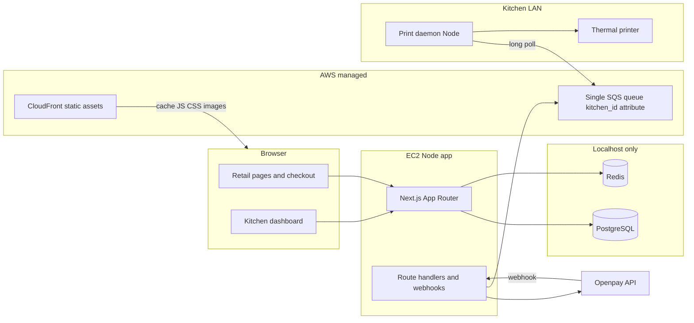
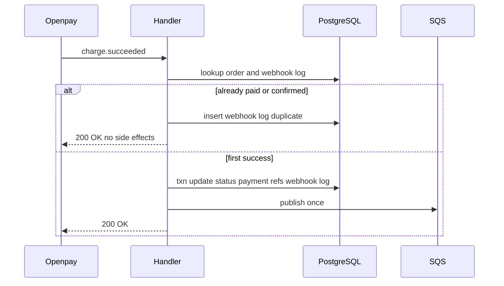
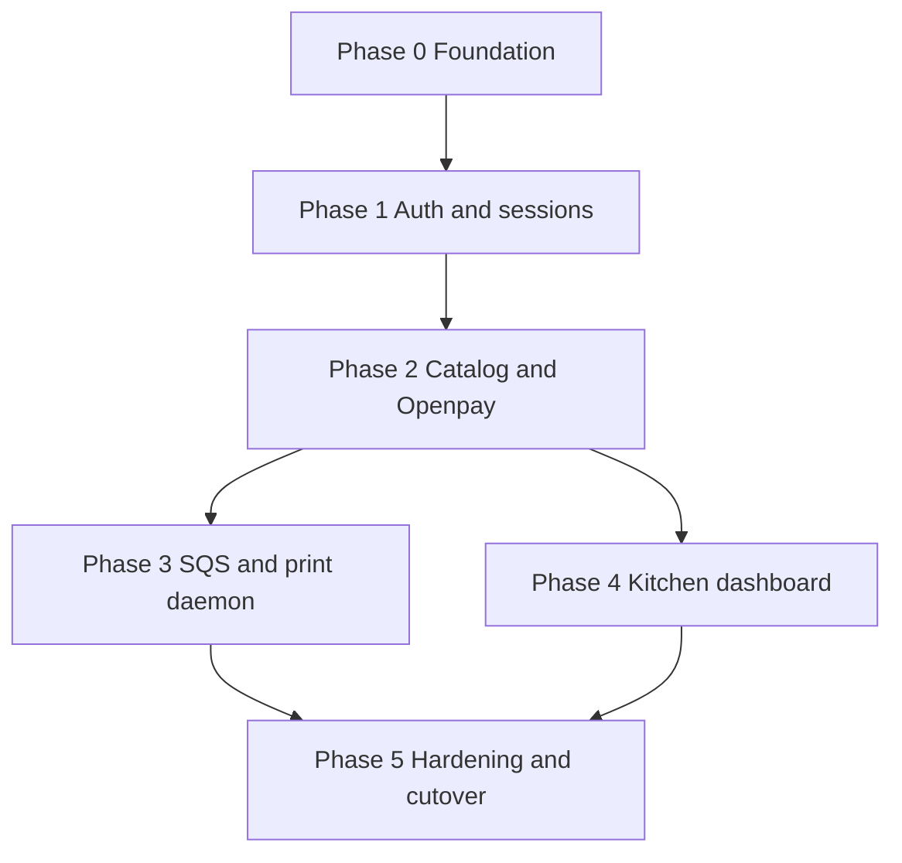

# Power Meals retail platform — phased implementation plan

Phased upgrade from static WhatsApp ordering to a Node-hosted Next.js app on EC2 with PostgreSQL, Redis sessions, Openpay checkout, SQS kitchen dispatch, per-facility print daemons, and a staff dashboard—preserving the existing brand UI and MapLibre patterns where possible.

Related: [power-meals-v2.md](./power-meals-v2.md) (engineering brief), [power-meals.md](./power-meals.md) (current product context).

## Implementation checklist

- [ ] **Phase 0:** Drop static export, systemd + EC2/Nginx, PostgreSQL + Redis, Drizzle schema/migrate + seed from `lib/*-data.ts`
- [ ] **Phase 1:** Redis sessions, Argon2id + pepper, auth rate limits, `/cuenta` `/historial`, kitchen role
  - [ ] 24h sliding TTL on `session:*` and `cart:session:*`; `REDIS_SESSION_TTL_SECONDS=86400`
  - [ ] Guest cart in Redis; `lib/cart/` helpers for touch + migration prep
- [ ] **Phase 2:** DB-backed catalog/cart, Openpay checkout + webhook, guest post-payment account linking
  - [ ] Strict webhook idempotency + `openpay_webhook_events`; no duplicate SQS on replay
  - [ ] Migrate guest cart → `cart_lines` on login/link; clear `cart_lines` on first paid webhook
- [ ] **Phase 3:** Single SQS queue + `kitchen_facility_id` attributes, print-daemon filter per LAN facility
  - [ ] Print failures: no delete, `ChangeMessageVisibility` backoff (60–300s), non-blocking poll loop
- [ ] **Phase 4:** `/kitchen/dashboard` with 10s polling, facility-scoped orders and status lifecycle
- [ ] **Phase 5:** Openpay prod toggle + powermeals.mx webhook, EC2 stability gate, sunset Cloudflare static

---

## Context and starting point

Today the app is a **static export** ([`next.config.ts`](./next.config.ts): `output: "export"`) deployed via Wrangler/Cloudflare. Catalog and zones live in [`lib/menu-data.ts`](./lib/menu-data.ts) and [`lib/locations-data.ts`](./lib/locations-data.ts). Checkout is [`components/OrderForm.tsx`](./components/OrderForm.tsx) → WhatsApp deep link ([`lib/whatsapp.ts`](./lib/whatsapp.ts)).

v2 target ([`power-meals-v2.md`](./power-meals-v2.md)): full Node server on **EC2 + Nginx**, **PostgreSQL** and **Redis** on localhost, **Openpay**, **Redis-backed sessions**, **SQS** after paid orders, **kitchen dashboard**, **per-kitchen LAN print daemon**. Checkout: **guest first, optional account link after payment**.



---

## Decisions locked in

| Area | Choice |
|------|--------|
| Payments | **Openpay** hosted flow; no PAN/CVV on EC2; store charge id, status, amounts only |
| Checkout identity | **Guest checkout**; post-payment **“create account to save this order”** (email + password) linking `orders.guest_email` / session to `users.id` |
| Print path | **One daemon per kitchen facility** on a local PC; polls **shared** SQS queue, filters by `kitchen_facility_id` attribute, prints ESC/POS |
| Sessions | Redis cookie session id; `HttpOnly`, `Secure`, `SameSite=Strict` |
| Passwords | Argon2id + per-user salt + env **pepper** |
| Hosting | EC2 Node (`next start`); **systemd** unit for app; Nginx reverse proxy; CloudFront for static edge cache |
| Data layer | **Drizzle ORM** + versioned migrations in repo (`drizzle/`); optional `schema.sql` snapshot for ops |
| Openpay UX | **Redirect checkout** (hosted payment page); webhook confirms payment; sandbox → prod keys in env |
| SQS | **Single queue**; `MessageAttributes.kitchen_facility_id` on publish; each LAN daemon long-polls same queue and **skips/deletes only messages matching its facility** |
| Kitchen dashboard | **10-second client polling** to refresh order list (no SSE/WebSockets in v1) |
| Checkout UX | **Openpay primary** (pay CTA); secondary text button **“¿Prefieres pagar por WhatsApp?”** reuses [`lib/whatsapp.ts`](./lib/whatsapp.ts) prefilled `wa.me` link (transfer flow, no card) |
| Deploy | **Sunset Cloudflare static** ([`wrangler.jsonc`](./wrangler.jsonc)) after EC2 Node app is live, stable, and DNS cut over; archive steps in `docs/legacy-static-deploy.md` |
| Openpay config | Env-driven **sandbox vs production** toggle (see below); production webhook registered in Openpay dashboard |
| Webhook idempotency | **Strict state gate:** if order already `paid`/`confirmed`, log duplicate and **200 OK** with no SQS or status side effects; audit in **`openpay_webhook_events`** |
| Session / cart memory | **24h sliding TTL** on anonymous sessions and guest carts in Redis; logged-in working cart in **`cart_lines`** (PostgreSQL) until checkout completes—**not** a long-term saved cart |

## `kitchen_facilities` (PostgreSQL + Drizzle)

Dedicated table for production kitchen / dispatch locations. Coordinates stored as `latitude` / `longitude` (decimal); map code can use `[longitude, latitude]` when interfacing with MapLibre.

| Column (conceptual) | Purpose |
|---------------------|---------|
| `id` | UUID or serial PK |
| `slug` | Stable key for SQS attributes, daemon env, staff scoping |
| `name` | Display name (Spanish labels as shown) |
| `latitude`, `longitude` | Facility pin |
| `is_active` | Soft-disable without deleting history |

**Seed rows (Phase 0 migration + seed script):**

| slug | name | latitude | longitude |
|------|------|----------|-----------|
| `zona-rio` | Zona Río | 32.52820512415235 | -117.01893541543576 |
| `otay` | Otay | 32.53809645350098 | -116.92983513766147 |
| `plaza-monarca` | Plaza Monarca | 32.500821014237935 | -116.92067276725912 |
| `rio-tijuana-3ra-etapa` | Rio Tijuana 3ra Etapa | 32.497178312977205 | -116.93127319919203 |

**Routing at checkout:** `delivery_zones.kitchen_facility_id` and `pickup_points.kitchen_facility_id` (NOT NULL FK). Seed from [`lib/locations-data.ts`](./lib/locations-data.ts): direct match where slugs align (`zona-rio` zone → `zona-rio` facility, `otay` zone → `otay` facility); remaining zones/points get an initial FK via seed rules documented in `scripts/seed-from-static-data.ts` (ops can reassign in DB without code deploy). `orders.kitchen_facility_id` is copied from the chosen zone or pickup point at order creation.

**Staff & print:** Kitchen users carry `users.kitchen_facility_id`; print daemon env `KITCHEN_FACILITY_ID` matches `kitchen_facilities.id` or slug per implementation convention.

## Openpay environment and webhooks

**Client module** (`lib/openpay/`): single factory reads env and selects API base URL:

- `OPENPAY_SANDBOX_MODE=true` → `https://sandbox-api.openpay.mx`
- `OPENPAY_SANDBOX_MODE=false` (or unset in prod) → `https://api.openpay.mx` (production)

**Required env vars:**

```bash
# Development (.env — chmod 600 on server)
OPENPAY_MERCHANT_ID=
OPENPAY_PRIVATE_KEY=
OPENPAY_SANDBOX_MODE=true

# Production (same keys, different values; flip sandbox flag)
OPENPAY_SANDBOX_MODE=false
```

Optional but recommended: `.env.example` in repo with empty values and comments; never commit real keys.

**Webhook endpoint (production):** Register in Openpay dashboard:

`https://powermeals.mx/api/webhooks/openpay`

**Handler behavior** (`POST /api/webhooks/openpay`):

- Verify Openpay signature / auth per their docs.
- Resolve `order_id` from payload (Openpay charge / order reference stored when creating the redirect charge).
- Sandbox: register parallel webhook URL (ngrok or staging host) with sandbox merchant; same handler code path.

### Webhook idempotency (strict)

Before updating order status or publishing to SQS, read current `orders.status`. Fulfillment and dispatch run **only** on the first successful transition from a non-terminal payment state.



**Rules:**

- **State gate:** If `orders.status` is already `paid` or `confirmed`, log the event as a duplicate, persist an audit row in `openpay_webhook_events` when not already stored for this event/transaction id, return **`200 OK` immediately**. Do **not** update status again, **do not** publish to SQS, **do not** trigger duplicate fulfillment side effects.
- **First-time success:** In a single DB transaction: set status to `paid` / `confirmed`, write Openpay charge/transaction ids on `payments` / `orders`, insert processed webhook record, **delete `cart_lines` for the order’s user** (if `user_id` is set). Enqueue SQS (Phase 3) only in this first-success path—or immediately after commit using an idempotency key tied to `order_id` so replays cannot double-send.
- On **`charge.succeeded`** (and equivalent success types): follow the branch above (redirect return alone is not sufficient).

**Table `openpay_webhook_events`** (Phase 0 Drizzle):

| Column | Purpose |
|--------|---------|
| `id` | PK |
| `openpay_event_id` | Unique when present |
| `openpay_transaction_id` / `charge_id` | Unique fallback for idempotency |
| `order_id` | FK → `orders` |
| `event_type` | e.g. `charge.succeeded` |
| `raw_payload` (jsonb, redacted) or `payload_hash` | Audit |
| `processed_at` | Timestamp |
| `is_duplicate` | Boolean for replay logging |

Unique indexes on `openpay_event_id` and/or `openpay_transaction_id` where applicable.

**Phase 5 toggle checklist:** swap merchant id + private key, set `OPENPAY_SANDBOX_MODE=false`, confirm dashboard webhook URL points at production domain, smoke-test redirect + webhook + order row update before disabling sandbox keys.

## Session and cart memory (Redis + PostgreSQL)

**Redis key patterns:**

- `session:{sessionId}` — session payload (`userId`, `role`, etc.)
- `cart:session:{sessionId}` — guest cart (dish id/slug → quantity)

**TTL policy:**

- Anonymous sessions and guest carts: **24 hours**, **sliding expiration**—refresh TTL (`EXPIRE`) on each session touch, authenticated request, or cart mutation.
- Env: `REDIS_SESSION_TTL_SECONDS=86400` (default 86400). Rate-limit keys may use shorter TTLs.

**Cart persistence (until checkout only):**

- **Guest:** cart lives only in Redis (`cart:session:{sessionId}`).
- **On login or post-payment account link:** migrate guest cart into PostgreSQL **`cart_lines`**: `user_id`, `dish_id`, `quantity`, `updated_at`; merge overlapping lines; delete guest Redis cart key; bind session to `userId`.
- **Logged-in shopper:** read/write `cart_lines` in PostgreSQL for the active shopping session.
- **After successful payment (webhook first-success):** delete all `cart_lines` for that user; clear any optional Redis `cart:user:{userId}` cache. No long-term saved cart between visits.

Implement migration in `lib/cart/` (called from auth and account-link flows in Phase 2).

---

## Phase 0 — Platform foundation (infra + app mode switch)

**Goal:** Runnable Node app on EC2 with health checks, secrets discipline, and schema ready for seed.

**Work:**

- Remove `output: "export"`; enable `next start` behind Nginx (upstream to `127.0.0.1:3000`); ship **systemd** unit (`power-meals.service`: `WorkingDirectory`, `EnvironmentFile`, `Restart=on-failure`).
- Re-enable **Next image optimization** if desired (server now available); otherwise keep unoptimized initially to reduce diff.
- Document server layout: `.env` (`chmod 600`), PostgreSQL `listen_addresses = 'localhost'`, Redis `bind 127.0.0.1` + `requirepass`, security groups blocking 5432/6379.
- **Drizzle**: `lib/db/schema.ts`, `drizzle.config.ts`, `drizzle-kit migrate`; tables include **`kitchen_facilities`** (four seeded locations above), `users` (role enum + optional `kitchen_facility_id` for staff), `categories`, `dishes`, `delivery_zones`, `pickup_points` (both FK → `kitchen_facilities`), `orders` (`kitchen_facility_id`), `order_items`, `payments` (Openpay ids), **`cart_lines`**, **`openpay_webhook_events`**, optional `order_status_events`.
- Seed script: import [`dishes`](./lib/menu-data.ts), [`zones` / `pickupPoints`](./lib/locations-data.ts), and **kitchen facility rows**; wire zone/point → facility FKs.
- Add `.env.example` documenting Openpay, DB, Redis (`REDIS_SESSION_TTL_SECONDS`), SQS, and `OPENPAY_SANDBOX_MODE`.
- Add `GET /api/health` (DB + Redis ping) for Nginx/monitoring.
- CloudFront: cache `/_next/static`, `/images`, `/public` assets; bypass cache for `/api/*`, `/kitchen/*`, authenticated HTML.

**Exit criteria:** `npm run build && npm start` on EC2; health green; menu readable from DB in dev.

**Status (branch `v2`):** Code complete. Schema in [`lib/db/schema.ts`](./lib/db/schema.ts), migration [`drizzle/0000_init.sql`](./drizzle/0000_init.sql), seed [`lib/db/seed.ts`](./lib/db/seed.ts), health route [`app/api/health/route.ts`](./app/api/health/route.ts), systemd/Nginx files in [`deploy/`](./deploy/), runbook [`docs/ec2-setup.md`](./docs/ec2-setup.md). Migration + seed verified against an in-process Postgres (PGlite); remaining: run `db:migrate` / `db:seed` on EC2 and confirm `/api/health` returns 200.

---

## Phase 1 — Identity, sessions, and authorization

**Goal:** Secure accounts for customers and kitchen staff; foundation for protected routes.

**Work:**

- Redis session store module (`lib/session/`): create/destroy session, attach `userId`, `role`; **sliding TTL** via `REDIS_SESSION_TTL_SECONDS` (default 24h) on every read/write.
- **`lib/cart/`:** guest cart get/set/touch on `cart:session:{sessionId}` with same sliding TTL; stub **migrateGuestCartToUser(sessionId, userId)** for Phase 2 login/link flows.
- Registration/login server actions or route handlers with **rate limiting** (Redis sliding window on IP + email for `/api/auth/*`).
- Argon2id hash at register; pepper from `PASSWORD_PEPPER` env.
- Routes: `/cuenta` (profile), `/historial` (order list scoped by `user_id`), middleware or layout guards.
- Kitchen role: seed staff users; deny `/kitchen/*` unless `role = kitchen_staff` (and optional `kitchen_facility_id` scoping).
- Guest session: anonymous session id in Redis for **cart** before login (see **Session and cart memory**).

**Exit criteria:** Customer sees only own orders; staff user cannot access `/historial` of others; auth endpoints rate-limited; guest session/cart keys expire after 24h without activity and TTL refreshes on touch.

---

## Phase 2 — Catalog, cart, and Openpay checkout

**Goal:** Openpay as primary conversion; paid orders in PostgreSQL; WhatsApp preserved as fallback.

**Work:**

- Refactor menu/ubicaciones/pedido to load catalog from DB (keep same Spanish UX and deep links: `?platillo=`, `?zona=`, `?punto=`).
- **Cart:** guests use Redis (`cart:session:*`); authenticated users use **`cart_lines`** in PostgreSQL; sync quantities server-side; validate prices at checkout time from DB (never trust client totals).
- **Login / account link:** call `migrateGuestCartToUser`—merge into `cart_lines`, remove guest Redis cart key.
- Refactor [`OrderForm.tsx`](./components/OrderForm.tsx) (or successor):
  - **Primary submit:** “Pagar con Openpay” (or brand-aligned label) → server creates order + redirect URL.
  - **Secondary control:** link-style button **“¿Prefieres pagar por WhatsApp?”** → existing [`buildWhatsAppUrl`](./lib/whatsapp.ts) / popup-blocked fallback UX; does **not** create a paid `orders` row unless you later add manual order ingestion.
- Checkout flow (Openpay path):
  1. Collect guest contact (name, phone, email for receipt/link) + fulfillment fields (reuse validation from current form).
  2. Create `orders` row `status = pending_payment`, line items, set `kitchen_facility_id` from zone/pickup FK.
  3. Create Openpay **redirect** charge using sandbox or prod base URL from `OPENPAY_SANDBOX_MODE`; customer returns to success/cancel URLs on EC2.
  4. **Webhook** `POST /api/webhooks/openpay`: implement **strict idempotency** (see **Webhook idempotency (strict)**)—`charge.succeeded` only drives paid status, SQS, and cart clear on first success.
  5. Success page: order summary + **“Crear cuenta”** pre-filled email → link order to new user (one-time token in Redis or signed link); account link also runs cart migration if a guest cart remains.
- Logging: structured logs without card data; webhook replay protection via `openpay_webhook_events` + order status gate.

**Exit criteria:** End-to-end sandbox payment creates paid order; guest can link account; order appears in `/historial` after link; replaying the same webhook twice yields one SQS publish and second response **200 OK** with duplicate audit log; login preserves cart via `cart_lines`; paid webhook clears `cart_lines` for the user.

---

## Phase 3 — Kitchen dispatch (SQS + receipt contract)

**Goal:** Every paid order reliably reaches the correct kitchen for printing and dashboard.

**Work:**

- After webhook **first-success** commit: publish JSON body to **one shared SQS queue** with `MessageAttributes`: `kitchen_facility_id` (String), optional `order_id` for tracing (never publish on duplicate webhook).
- Payload spec: order id, facility, customer phone, fulfillment type, address/pickup, line items, notes, timestamps, status.
- DLQ on queue + max receives; CloudWatch alarm on DLQ depth.

### Print daemon — success, failure, and non-blocking poll

**`packages/print-daemon`:** Node CLI; env `AWS_*`, `QUEUE_URL`, `KITCHEN_FACILITY_ID`, printer target, optional `PRINT_RETRY_VISIBILITY_SECONDS` (default **120**, acceptable range **60–300**).

| Outcome | SQS action |
|---------|------------|
| Print success | `DeleteMessage` |
| Print failure (offline, paper out, timeout, connection loss, ESC/POS error) | **Do not** delete; `ChangeMessageVisibility` with backoff (env or exponential per receive count, capped at 300s); log `order_id`, facility, error |

**Poll loop:**

- Default **single-threaded** long poll: after handling one message (success or visibility extension), call `ReceiveMessage` again immediately—do not sleep the loop for the full backoff duration (backoff is queue-side visibility).
- Messages for **other facilities:** skip without tight retry loops; optionally short visibility extension so peer daemons can consume.
- If adding workers/async later: per-message try/catch so one failure cannot stall the receiver; never block the only poll thread on long sleeps while other messages wait.

**Ops:** Poison jobs land in **DLQ** after `maxReceiveCount`; fix printer → message becomes visible again and retries automatically.

- IAM: daemons need `ReceiveMessage`, `DeleteMessage`, `ChangeMessageVisibility` on the single queue (shared creds per site acceptable if kitchen PCs are trusted; document rotation).
- Receipt template: 80mm thermal, Spanish labels, matches kitchen’s current WhatsApp message clarity ([`lib/whatsapp.ts`](./lib/whatsapp.ts) as reference).

**Exit criteria:** Sandbox order prints at one kitchen; simulated print failure leaves message on queue, visibility resets after backoff, successful retry deletes message; poll loop continues processing other messages; DLQ documented.

---

## Phase 4 — Kitchen staff dashboard

**Goal:** Staff manage order lifecycle without WhatsApp for status.

**Work:**

- Route: `/kitchen/dashboard` (Spanish UI, minimal chrome, large touch-friendly rows).
- List orders for staff’s `kitchen_facility_id`, filters: Pending → Preparing → Ready → Completed.
- Status updates: server action → PostgreSQL + append `order_status_events`; optional notify customer (email/SMS out of scope unless requested).
- **10s interval polling** (`setInterval` + `fetch` or server action) for active-order list; pause when tab hidden optional (`document.visibilityState`).
- Optimistic UI on status change with rollback on error.
- Optional: sound/badge for new paid orders (detect new ids between poll ticks).

**Exit criteria:** Status changes persist; retail `/historial` reflects status; only assigned facility orders visible.

---

## Phase 5 — Hardening, observability, and cutover

**Goal:** Production-ready retail experience on EC2.

**Work:**

- CSP updates in Nginx or Next headers: Openpay domains, retain MapTiler rules from [`public/_headers`](./public/_headers) pattern.
- Backups: PostgreSQL daily to encrypted S3 (or EBS snapshots); Redis treated as ephemeral (sessions/carts OK to lose; document).
- Nginx rate limits aligned with app-level auth limits.
- Runbook: deploy, migrate, rollback, **Openpay sandbox → production** (merchant id, private key, `OPENPAY_SANDBOX_MODE=false`, webhook URL `https://powermeals.mx/api/webhooks/openpay`), rotate pepper (requires re-hash strategy or accept login-only rotation).
- Load test checkout webhook idempotency (`charge.succeeded` replay).
- **Sunset Cloudflare static deploy** only after EC2 Node app passes stability criteria (health checks green, checkout + webhook smoke tests, brief soak period); then remove Workers as primary origin, point `powermeals.mx` at EC2/CloudFront per v2, move [`wrangler.jsonc`](./wrangler.jsonc) guidance to `docs/legacy-static-deploy.md`.

**Exit criteria:** Production Openpay live; webhook updates orders; Cloudflare static path retired; checklist signed off.

---

## Recommended repo structure (incremental)

```
app/
  (marketing pages — existing)
  pedido/          # checkout (server + client islands)
  cuenta/
  historial/
  kitchen/dashboard/
  api/
    health/
    webhooks/openpay/
    auth/          # if using route handlers vs only server actions
lib/
  db/              # Drizzle client, schema.ts, queries
  session/
  cart/            # Redis guest cart, cart_lines access, migration
  openpay/
  sqs/
  auth/
  catalog/         # DB reads replacing direct menu-data imports
packages/
  print-daemon/    # deployable separately to kitchen PCs
drizzle/           # Drizzle Kit migrations + meta
deploy/
  systemd/power-meals.service
  nginx/powermeals.conf
scripts/
  seed-from-static-data.ts
docs/
  ec2-setup.md
  legacy-static-deploy.md
PLAN.md            # this document
```

---

## Phase dependency graph



Phases 3 and 4 can overlap once Phase 2 webhooks are stable.

---

## v2 deliverables mapping

| v2 deliverable | Where it lands |
|--------------|----------------|
| Project file structure | Recommended repo structure above |
| Database schema | Drizzle `lib/db/schema.ts` + `drizzle/` migrations; optional `schema.sql` |
| Redis session configuration | `lib/session/` (Phase 1) |
| Order placement + SQS dispatch | Openpay webhook handler + `lib/sqs/` (Phases 2–3) |
| Kitchen dashboard layout | `app/kitchen/dashboard/` (Phase 4) |
