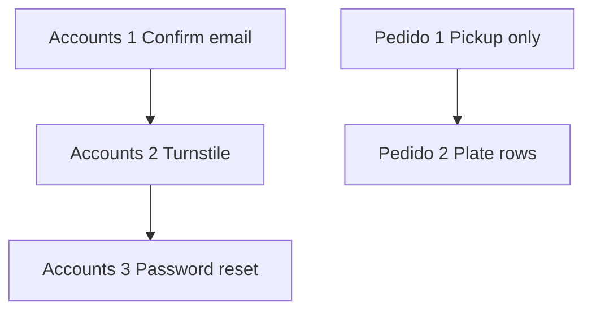

# Power Meals — remaining work

The retail app is built and running locally: catalog and cart, WhatsApp orders, kitchen dashboard, receipt tracker, print outbox, and the paid-order notification outbox. This file is what is left. `power-meals.md` is the old static site. `power-meals-v2.md` is the original build prompt. [`.cursor/rules/application.mdc`](./.cursor/rules/application.mdc) is the runtime model. When they disagree, follow the code.

## Already built

- [x] Platform: Next.js on Node, PostgreSQL, Redis sessions, Drizzle schema and seed
- [x] Customer auth, `/cuenta`, `/historial`, kitchen staff role
- [x] Catalog, cart, guest checkout, WhatsApp order ingestion (`ordered_whatsapp`, not paid)
- [x] Openpay checkout and webhook code, kept off until [Openpay](#openpay)
- [x] Kitchen dashboard, facility-scoped, 10s poll
- [x] Kitchen ticket outbox and print daemon. A real AWS queue has not been exercised; setup is in [`docs/ec2-setup.md`](./docs/ec2-setup.md#kitchen-printing-sqs)
- [x] Receipt tracker at `/pedido/success?order_ref=`
- [x] One message when an order first becomes Pagado: email if the order has an address, otherwise WhatsApp. Later kitchen steps send nothing

## Still to build

The account phases and the pedido phases do not depend on each other. Accounts phase 1 can ship alone. It needs the SES sender (`ORDER_EMAIL_FROM`). Phase 2 needs a Cloudflare Turnstile site key and secret. Phase 3 reuses that widget and SES. Pedido 1 can ship alone. Pedido 2 keeps the Paquetes layout as it is.

### Accounts 1 — Confirm the email

**Goal:** A person who just registered cannot sign in until they open the link in the confirmation email.

**Work:**

- Add `users.email_verified_at`. Backfill every current row to now so existing customers and kitchen staff can still sign in. New rows leave it null. [`scripts/create-staff-user.ts`](./scripts/create-staff-user.ts) sets it.
- [`app/api/auth/register/route.ts`](./app/api/auth/register/route.ts) inserts the user, stores a single-use token in Redis (`verify:email:{token}`, 24 hours), and sends a Spanish message with `/verificar?token=`. It does not call `rotateSession`, move the cart, or claim a WhatsApp order. The page tells them to check the inbox.
- Opening the link sets `email_verified_at`, deletes the token, signs the person in, and sends them to `/cuenta`. The next login does the cart move and WhatsApp claim that login already does.
- [`app/api/auth/login/route.ts`](./app/api/auth/login/route.ts) rejects a correct password when `email_verified_at` is null and tells them to confirm. A wrong password stays the current generic error.
- "Enviar de nuevo" on that message, and when registration finds an unverified email. Rate limit it per address. The response does not say whether some other email exists.
- [`components/order/LinkOrderPanel.tsx`](./components/order/LinkOrderPanel.tsx) stops linking the order in the same step as registration. After they confirm and sign in, the receipt's "guardar este pedido" panel still works while its link token is valid.

**Exit criteria:** A new registration does not create a session. Login with the right password before the link is opened is refused. Opening the link signs them in, and a second login works. An account that already existed can still sign in. With SES unset, no user row is inserted.

**Status:** Done. Existing accounts were backfilled. A new registration does not sign anyone in, login before the link is refused, and opening the link lands on `/cuenta`. A failed confirmation send does not keep the new user.

### Accounts 2 — Turnstile on registration

**Goal:** `/registro` rejects a submit that did not pass Cloudflare Turnstile.

**Work:**

- Widget in [`components/auth/AuthForm.tsx`](./components/auth/AuthForm.tsx) when the mode is register. Site key: `NEXT_PUBLIC_TURNSTILE_SITE_KEY`.
- [`app/api/auth/register/route.ts`](./app/api/auth/register/route.ts) calls Cloudflare `siteverify` with `TURNSTILE_SECRET_KEY` before inserting the user. A missing or failed token is rejected.
- Document both env vars in [`.env.example`](./.env.example).

**Exit criteria:** Registration without a valid token does not create a user. A token Cloudflare accepts continues into the confirmation email.

**Status:** Done. A missing or rejected token is refused and no user is created. A token Cloudflare accepts continues into the confirmation email.

### Accounts 3 — Reset the password

**Goal:** Anyone with the account email can set a new password from a link, and the request form requires Turnstile.

**Work:**

- `/recuperar` asks for the email, checks Turnstile with the phase 2 widget and secret, and always answers the same sentence. When the address belongs to a user, Redis stores `reset:password:{token}` for 1 hour and SES sends `/recuperar/nueva?token=`.
- That page sets a new password (minimum 10 characters, same rules as registration), deletes the token, and signs them in. A used or expired token shows a Spanish error and a link back to `/recuperar`. The new-password form does not show Turnstile; the link is the secret.
- [`/ingresar`](./app/ingresar/page.tsx) links to `/recuperar`.

**Exit criteria:** Requesting a reset for a real account sends one email, and the same request for an unknown address shows the same sentence and sends nothing. The link sets a new password once. The old password then fails, and the new one signs them in. A request without a valid Turnstile token sends nothing.

**Status:** Done. A request without Turnstile sends nothing. A known address and an unknown address get the same sentence. The link sets the password once and signs the person in; the old password then fails.

After Accounts 3, update [`.cursor/rules/application.mdc`](./.cursor/rules/application.mdc) so later work treats public registration as unverified until the email link, Turnstile as the gate on registration and reset requests, and the email link as the only password reset.

### Pedido 1 — Recolección and delivery

**Goal:** Checkout can only be completed as pickup at the four kitchens shown on the map. Delivery is visible and cannot be selected.

**Work:**

- In [`components/order/CheckoutForm.tsx`](./components/order/CheckoutForm.tsx), show "Entrega a domicilio" disabled, with a short Spanish note that it is not available yet. Recolección is selected and is the only path that continues.
- Replace the two pickup points in [`lib/locations-data.ts`](./lib/locations-data.ts) (`recoleccion-zona-rio`, `recoleccion-playas`) with the four kitchens from [`lib/kitchens.ts`](./lib/kitchens.ts): Zona Río, Otay, Plaza Monarca, Rio Tijuana 3ra Etapa. Show the kitchen name. The map pins have no street address, so the choice does not invent one.
- Seed `pickup_points` so each of those choices belongs to that kitchen. [`lib/orders/fulfillment.ts`](./lib/orders/fulfillment.ts) already copies the kitchen from the pickup point. Reject a posted delivery so a crafted request cannot place one while the option is disabled.
- After this ships, update [`.cursor/rules/application.mdc`](./.cursor/rules/application.mdc): checkout pickup points are these four kitchens, and delivery is off until it is turned back on.

**Exit criteria:** Checkout lists the four kitchens and no other pickup point. Delivery cannot be chosen and cannot be submitted. An order for Otay is assigned to the Otay kitchen.

### Pedido 2 — Arma tu platillo rows

**Goal:** The customer confirms one plate at a time. Each confirm adds it to the cart and leaves a new empty row underneath. The switch between Arma tu platillo and Paquetes stays, and the package layout stays as it is.

**Work:**

- Rework [`components/order/MealBuilder.tsx`](./components/order/MealBuilder.tsx). The open row has dropdowns for Base and Proteína, and buttons underneath for tamaño, estilo, and salsa. Confirmar is disabled until all five are chosen. It adds one cart line at quantity 1, then shows a new empty row below.
- A confirmed plate shows its details, a quantity stepper, and a trash control that removes that line. Quantity and delete use the cart the page already has (max 30 lines, quantity 1–20). The package builder is unchanged.
- Move the plantillas to the bottom. Choosing one fills Base, Proteína, and the other selectors on the open empty row. It does not add a line by itself.
- The cart summary stays for the total and checkout. Confirmed plates appear there too.

**Exit criteria:** Confirming two different plates leaves two cart lines and one empty row. Changing quantity or deleting a confirmed plate updates the cart. A plantilla only fills the open row. A package added from Paquetes is unchanged.

## Turn on later

These are already implemented. They stay off until the outside account exists. Turning one on does not send or print a backlog: an unconfigured channel is stored as `skipped`.

### Openpay

Do not start until sandbox credentials exist. No new payment design.

- Set `OPENPAY_MERCHANT_ID`, `OPENPAY_PRIVATE_KEY`, `OPENPAY_SANDBOX_MODE=true`, `OPENPAY_WEBHOOK_USER`, and `OPENPAY_WEBHOOK_PASSWORD`. Set `NEXT_PUBLIC_SITE_URL` before building; it is inlined at build time, including the redirect URL.
- Register the webhook URL in the Openpay dashboard with those basic-auth credentials. Confirm the verification code from the `openpay.webhook` log.
- Run one real sandbox payment: pending order, redirect, webhook marks `paid` once, replay is `duplicate`, guest cart clears, `/pedido/success` shows the receipt. That first success also queues the kitchen ticket and the paid-order message.
- Home, `/menu`, the footer, and `/pedido` already follow `isOpenpayConfigured()` and switch to the card-payment copy when both keys are set.

Production keys wait for the cutover below: `OPENPAY_SANDBOX_MODE=false` and webhook `https://powermeals.mx/api/webhooks/openpay`, only after the sandbox payment has worked.

### WhatsApp template

The Cloud API sender is in [`lib/whatsapp-cloud.ts`](./lib/whatsapp-cloud.ts). It sends only when all three are set:

- `WHATSAPP_TOKEN`
- `WHATSAPP_PHONE_NUMBER_ID` (the phone number id from Meta, not the display number)
- `WHATSAPP_TEMPLATE_NAME`

Wait until Meta approves one Spanish (`es_MX`) utility template. Body variables, in order: first name, order number, receipt link. A 10-digit Mexican number is sent as `52` plus those digits. Orders that have an email still get email only. Do not use the `wa.me` link to message the customer.

### Real kitchen queue

Code is done and was verified against a local stand-in. Creating `power-meals-kitchen`, the DLQ, and the EC2 and kitchen IAM permissions is in [`docs/ec2-setup.md`](./docs/ec2-setup.md#kitchen-printing-sqs). Set `SQS_QUEUE_URL` after that. Orders already marked `skipped` are not printed.

### Production cutover

After Openpay sandbox works and the app is on EC2:

- CSP for Openpay domains. PostgreSQL backups. Nginx rate limits aligned with the app limits.
- Point `powermeals.mx` at EC2. Register the production Openpay webhook. Set `OPENPAY_SANDBOX_MODE=false`.
- Retire the Cloudflare static deploy only after health checks, a checkout smoke test, and a short soak. Move [`wrangler.jsonc`](./wrangler.jsonc) guidance to `docs/legacy-static-deploy.md`.
