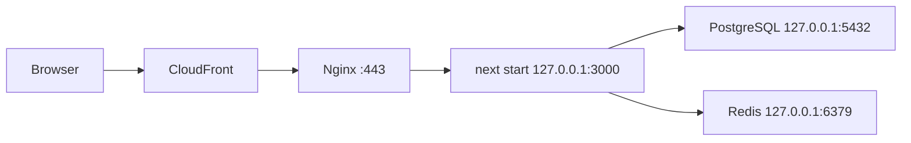

# EC2 server setup (Phase 0)

How the Node.js app, PostgreSQL, and Redis run on the existing EC2 instance. Commands assume Ubuntu with systemd; adjust package names for Amazon Linux.



## 1. App user and layout

```bash
sudo useradd --system --no-create-home --home-dir /srv/power-meals --shell /usr/sbin/nologin powermeals
sudo install -d -o powermeals -g powermeals /srv/power-meals
sudo -u powermeals git clone <repo-url> /srv/power-meals
```

Node 22.9 or newer is required (`.node-version` pins 22; `db:seed` relies on `--env-file-if-exists`).

## 2. Secrets

```bash
sudo -u powermeals cp /srv/power-meals/.env.example /srv/power-meals/.env
sudo -u powermeals nano /srv/power-meals/.env
sudo chmod 600 /srv/power-meals/.env
```

The systemd unit loads this file through `EnvironmentFile`. Nothing secret lives in the repo or in the unit file.

`PASSWORD_PEPPER` (`openssl rand -base64 32`) is mixed into every password hash. If it is lost or changed, nobody can log in, so back it up alongside the database credentials.

## 3. PostgreSQL (localhost only)

The data directory must sit on an **encrypted EBS volume** (enable encryption when creating the volume; it cannot be toggled on an existing one).

`postgresql.conf`:

```
listen_addresses = 'localhost'
password_encryption = scram-sha-256
```

`pg_hba.conf` (remove any `0.0.0.0/0` or `::/0` lines):

```
local   all          postgres                    peer
host    powermeals   powermeals   127.0.0.1/32   scram-sha-256
host    powermeals   powermeals   ::1/128        scram-sha-256
```

```bash
sudo -u postgres psql -c "CREATE ROLE powermeals LOGIN PASSWORD '<strong-password>';"
sudo -u postgres psql -c "CREATE DATABASE powermeals OWNER powermeals;"
sudo systemctl restart postgresql
```

`gen_random_uuid()` is built in from PostgreSQL 13, so no extensions are needed.

## 4. Redis (localhost only, password, bounded memory)

`/etc/redis/redis.conf`:

```
bind 127.0.0.1 -::1
protected-mode yes
port 6379
requirepass <strong-password>
maxmemory 256mb
maxmemory-policy volatile-lru
```

`volatile-lru` only evicts keys that carry a TTL. Sessions, guest carts, and rate-limit counters all have TTLs, so under memory pressure Redis drops the least recently used of those instead of failing writes on unrelated keys.

```bash
sudo systemctl restart redis-server
redis-cli -a '<strong-password>' ping   # PONG
```

## 5. Security groups

Inbound rules on the instance:

| Port | Source | Purpose |
|------|--------|---------|
| 443 | CloudFront origin-facing prefix list (`com.amazonaws.global.cloudfront.origin-facing`) | HTTPS from CloudFront |
| 80 | Same prefix list | Redirect / ACME challenge |
| 22 | Admin IP only (or SSM Session Manager, no rule) | SSH |

No rules for 5432, 6379, or 3000. Both data stores also bind to localhost, so a misconfigured security group alone does not expose them.

## 6. Deploy

```bash
cd /srv/power-meals
sudo -u powermeals git pull
sudo -u powermeals npm ci
sudo -u powermeals npm run db:migrate
sudo -u powermeals npm run db:seed        # idempotent upsert of catalog, zones, pickup points, kitchens
sudo -u powermeals npm run build
sudo systemctl restart power-meals
```

First install of the service:

```bash
sudo cp deploy/systemd/power-meals.service /etc/systemd/system/
sudo systemctl daemon-reload
sudo systemctl enable --now power-meals
journalctl -u power-meals -f
```

`db:seed` is safe to re-run: it upserts by slug and never deletes rows, except that each seeded meal template's filter tags are replaced with the ones in [`lib/catalog/seed-data.ts`](../lib/catalog/seed-data.ts). Zone and pickup-point routing to kitchens can be changed directly in the database; re-seeding does not overwrite `kitchen_facility_id` on existing zones or points.

### Kitchen staff accounts

Staff can't self-register. Create each account for one kitchen (`zona-rio`, `otay`, `plaza-monarca`, `rio-tijuana-3ra-etapa`):

```bash
cd /srv/power-meals
read -rs STAFF_PASSWORD && export STAFF_PASSWORD   # typed without echo, kept out of shell history
sudo -u powermeals --preserve-env=STAFF_PASSWORD npm run user:create-staff -- \
  --email cocina.otay@powermeals.mx --name "Cocina Otay" --facility otay
unset STAFF_PASSWORD
```

Staff log in at `/ingresar` and land on `/kitchen/dashboard`, which only shows their own kitchen.

### Openpay

1. Set `OPENPAY_MERCHANT_ID`, `OPENPAY_PRIVATE_KEY`, `OPENPAY_SANDBOX_MODE`, `OPENPAY_WEBHOOK_USER` and `OPENPAY_WEBHOOK_PASSWORD` in `.env`, and make sure `NEXT_PUBLIC_SITE_URL=https://powermeals.mx` before building. Without the merchant ID and key, `/pedido` hides the card button and offers WhatsApp only.
2. In the Openpay dashboard, add a webhook for `https://powermeals.mx/api/webhooks/openpay` with the same user and password (basic auth). Openpay sends a verification request first; paste the logged `verificationCode` back into the dashboard:

   ```bash
   journalctl -u power-meals | grep '"type":"verification"'
   ```

3. Subscribe at least `charge.succeeded`, `charge.failed` and `charge.cancelled`. The handler re-fetches every charge from the Openpay API and trusts only that status, so a forged body cannot mark an order paid.

### Kitchen printing (SQS)

Each kitchen PC runs [`packages/print-daemon`](../packages/print-daemon/README.md). The app sends one ticket to a shared SQS queue the first time an order becomes paid: staff confirming a WhatsApp transfer on the dashboard, or an Openpay `charge.succeeded`. Duplicate webhooks and later status changes send nothing.

1. Create the dead-letter queue `power-meals-kitchen-dlq` (standard queue, retention 14 days).
2. Create `power-meals-kitchen` (standard queue): visibility timeout 60 s, retention 4 days, receive wait 20 s, redrive to the DLQ with **maxReceiveCount 1000**. The count is high on purpose: every daemon receives every kitchen's tickets and hands back the ones that aren't its own, and each hand-back counts as a receive.
3. Add a CloudWatch alarm on the DLQ's `ApproximateNumberOfMessagesVisible` > 0.
4. Give the EC2 instance role `sqs:SendMessage` on `power-meals-kitchen` only, then set `SQS_QUEUE_URL` and `AWS_REGION` in `.env` and restart the app.
5. Create an IAM user for the kitchen PCs with only `sqs:ReceiveMessage`, `sqs:DeleteMessage` and `sqs:ChangeMessageVisibility` on the same queue. One shared key is acceptable while the PCs are trusted; rotate it when a PC is replaced or staff with access leave.
6. Install the retry timer. Every paid order writes a `kitchen_dispatches` row in the same transaction; the app sends it right after responding, and the timer retries anything still `pending` (SQS outage, restart before the send). After 60 failed attempts a row becomes `failed`.

   ```bash
   sudo cp deploy/systemd/power-meals-dispatch.service deploy/systemd/power-meals-dispatch.timer /etc/systemd/system/
   sudo systemctl daemon-reload
   sudo systemctl enable --now power-meals-dispatch.timer
   ```

Tickets that land in the DLQ (a kitchen PC was off too long, or a payload the daemon can't read) can be sent back with **Start DLQ redrive** in the SQS console once the cause is fixed. To see what the app could not send:

```bash
psql "$DATABASE_URL" -c "select o.order_number, d.status, d.attempts, d.last_error from kitchen_dispatches d join orders o on o.id = d.order_id where d.status <> 'sent' order by d.created_at desc limit 20"
```

### Paid-order email (SES)

The first transition to paid messages the customer once, with the receipt link. An order with an email is sent through SES. An order with a phone and no email is sent through the WhatsApp Cloud API (`WHATSAPP_TOKEN`, `WHATSAPP_PHONE_NUMBER_ID`, and `WHATSAPP_TEMPLATE_NAME` for an approved es_MX utility template whose body variables are first name, order number, and receipt link). Later kitchen steps do not send again. Give the EC2 role `ses:SendEmail` for the verified identity, set `ORDER_EMAIL_FROM` to that from-address (same `AWS_REGION` as SQS), and install the retry timer. A channel left unset records the row as `skipped`, so setting it later does not message old orders.

```bash
sudo cp deploy/systemd/power-meals-notify.service deploy/systemd/power-meals-notify.timer /etc/systemd/system/
sudo systemctl daemon-reload
sudo systemctl enable --now power-meals-notify.timer
```

```bash
psql "$DATABASE_URL" -c "select o.order_number, n.channel, n.status, n.attempts, n.last_error from order_notifications n join orders o on o.id = n.order_id where n.status <> 'sent' order by n.created_at desc limit 20"
```

## 7. Nginx

Merge [`deploy/nginx/powermeals.conf`](../deploy/nginx/powermeals.conf) into the existing config. Uncomment the `set_real_ip_from` block with CloudFront's origin-facing ranges; without it every rate limit applies per CloudFront edge rather than per client.

Security headers (CSP, HSTS, frame denial) are sent by Next.js from [`next.config.ts`](../next.config.ts), so Nginx does not need to add them.

## 8. Health check

```bash
curl -s http://127.0.0.1:3000/api/health
# {"status":"ok","checks":{"database":"ok","redis":"ok"}}
```

Returns `503` with `"degraded"` and the failing check when PostgreSQL or Redis is unreachable. Nginx only allows it from localhost by default.

## 9. CloudFront behaviors

| Path pattern | Cache policy | Notes |
|--------------|--------------|-------|
| `/_next/static/*` | CachingOptimized | Hashed filenames, immutable |
| `/images/*`, `/maplibre/*`, `/logo.svg` | CachingOptimized | Public assets |
| `/api/*` | CachingDisabled | Forward all headers, cookies, query strings |
| `/kitchen/*`, `/cuenta*`, `/historial*`, `/ingresar*`, `/registro*`, `/pedido*` | CachingDisabled | Session-bound pages; `/pedido*` also covers the Openpay return pages, which must forward the `order_ref` and `id` query strings |
| `/monitoring*` | CachingDisabled | Sentry tunnel: browser errors are POSTed here, so allow all HTTP methods |
| Default (`*`) | UseOriginCacheControlHeaders | Static marketing pages send `public` headers; dynamic ones send `private, no-store` |

Forward the session cookie only on the uncached behaviors so cached responses never vary by user.

## 10. Observability

Each tool covers one question. All of them are free or cost a few dollars a month at this traffic.

| Question | Tool | Alerts when |
|---|---|---|
| Is the site up? | UptimeRobot (free) | `https://powermeals.mx/` or `/menu` stops answering, or the TLS certificate is about to expire |
| Did a timer or a kitchen printer stop? | Healthchecks.io (free) | A check misses its ping, or receives `/fail` |
| Did an order, message or ticket get stuck? | Watchdog timer + Healthchecks.io | `npm run ops:watchdog` finds a problem (see below) |
| Did code throw? | Sentry (free Developer plan) | A new error type, or a spike |
| What happened around it? | CloudWatch Logs | `level` is `error` more than a few times, or any `alert.*` line |
| Is the disk or memory full? | CloudWatch agent | Disk > 80 %, memory > 90 % |

### Sentry

1. Create a Next.js project in Sentry. Set `NEXT_PUBLIC_SENTRY_DSN` in `.env` (and `NEXT_PUBLIC_SENTRY_ENVIRONMENT=staging` on a staging box), then rebuild: the DSN is inlined into the browser bundle.
2. Optional: set `SENTRY_ORG`, `SENTRY_PROJECT` and `SENTRY_AUTH_TOKEN` (an org token with source map upload) so `npm run build` uploads source maps and removes them from `.next`.
3. Browser errors go to `/monitoring` on this site and the server forwards them, so the CSP is unchanged. Add the `/monitoring*` CloudFront behavior from section 9.

[`lib/sentry-options.ts`](../lib/sentry-options.ts) turns off the SDK's default collection of headers, cookies, request bodies, query strings and stack-frame variables, and scrubs `order_ref` and `token` from URLs. Only the stack trace and the route are sent.

### Healthchecks.io

Create one check per row and put its ping URL in the matching `.env` (the kitchen ones in each PC's print-daemon `.env`):

| Check | Variable | Period | Grace |
|---|---|---|---|
| Notify retry timer | `HEARTBEAT_NOTIFY_URL` | 1 min | 5 min |
| Dispatch retry timer | `HEARTBEAT_DISPATCH_URL` | 1 min | 5 min |
| Watchdog | `HEARTBEAT_WATCHDOG_URL` | 5 min | 10 min |
| Nightly database backup ([section 11](#11-backups)) | `HEARTBEAT_BACKUP_URL` | 1 day | 2 h |
| One per kitchen printer | `HEARTBEAT_URL` (print daemon) | 1 min | 5 min |

Add an email (or the free Telegram integration) to the project. The watchdog check also goes red when PostgreSQL or Redis is unreachable, because the run fails.

### Watchdog

Runs every 5 minutes and logs one `alert.<check>` line per problem, with the order numbers:

| Check | Meaning |
|---|---|
| `notify.failed`, `dispatch.failed` | A paid-order message or kitchen ticket gave up after 60 attempts (last 24 h) |
| `notify.stuck`, `dispatch.stuck` | Still pending after `WATCHDOG_NOTIFY_STALE_MINUTES` (15) / `WATCHDOG_DISPATCH_STALE_MINUTES` (5) |
| `orders.paid_not_started` | Paid for more than `WATCHDOG_PAID_STALE_MINUTES` (60) and not yet `preparing` |
| `openpay.amount_mismatch` | A card charge did not match the order total (last 24 h) |
| `redis.memory_high` | Redis is above 90 % of `maxmemory` and will start evicting sessions and carts |

```bash
sudo cp deploy/systemd/power-meals-watchdog.service deploy/systemd/power-meals-watchdog.timer /etc/systemd/system/
sudo systemctl daemon-reload
sudo systemctl enable --now power-meals-watchdog.timer
sudo -u powermeals npm run ops:watchdog   # one run by hand
```

### CloudWatch Logs and host metrics

The app writes one JSON line per event ([`lib/log.ts`](../lib/log.ts)) with phones, emails and addresses masked. The CloudWatch agent reads files, not journald, so rsyslog copies those lines to `/var/log/power-meals/app.log`; `journalctl` keeps working as before.

1. Attach `CloudWatchAgentServerPolicy` to the EC2 instance role.
2. rsyslog and log rotation (the units' `SyslogIdentifier` is what the rule matches, so copy the updated units first):

   ```bash
   sudo cp deploy/systemd/power-meals*.service /etc/systemd/system/ && sudo systemctl daemon-reload
   sudo systemctl restart power-meals
   sudo cp deploy/rsyslog/30-power-meals.conf /etc/rsyslog.d/
   sudo cp deploy/rsyslog/power-meals.logrotate /etc/logrotate.d/power-meals
   sudo systemctl restart rsyslog
   tail -f /var/log/power-meals/app.log    # one JSON object per line
   ```

3. Install the agent and load [`deploy/cloudwatch/amazon-cloudwatch-agent.json`](../deploy/cloudwatch/amazon-cloudwatch-agent.json):

   ```bash
   sudo apt-get install -y ./amazon-cloudwatch-agent.deb   # from the AWS download page for your architecture
   sudo usermod -aG adm cwagent                            # read /var/log/power-meals and nginx logs
   sudo cp deploy/cloudwatch/amazon-cloudwatch-agent.json /opt/aws/amazon-cloudwatch-agent/etc/
   sudo /opt/aws/amazon-cloudwatch-agent/bin/amazon-cloudwatch-agent-ctl -a fetch-config -m ec2 -s \
     -c file:/opt/aws/amazon-cloudwatch-agent/etc/amazon-cloudwatch-agent.json
   ```

4. Metric filters, an SNS topic and the alarms:

   ```bash
   TOPIC=$(aws sns create-topic --name power-meals-alerts --query TopicArn --output text)
   aws sns subscribe --topic-arn "$TOPIC" --protocol email --notification-endpoint <you@example.com>

   aws logs put-metric-filter --log-group-name /power-meals/app --filter-name errors \
     --filter-pattern '{ $.level = "error" }' \
     --metric-transformations metricName=AppErrors,metricNamespace=PowerMeals,metricValue=1,defaultValue=0
   aws logs put-metric-filter --log-group-name /power-meals/app --filter-name alerts \
     --filter-pattern '{ $.event = "alert.*" }' \
     --metric-transformations metricName=WatchdogAlerts,metricNamespace=PowerMeals,metricValue=1,defaultValue=0

   alarm() { aws cloudwatch put-metric-alarm --alarm-actions "$TOPIC" --ok-actions "$TOPIC" \
     --treat-missing-data notBreaching --evaluation-periods 1 "$@"; }
   alarm --alarm-name power-meals-errors --namespace PowerMeals --metric-name AppErrors \
     --statistic Sum --period 300 --threshold 5 --comparison-operator GreaterThanOrEqualToThreshold
   alarm --alarm-name power-meals-watchdog --namespace PowerMeals --metric-name WatchdogAlerts \
     --statistic Sum --period 300 --threshold 1 --comparison-operator GreaterThanOrEqualToThreshold
   ```

   Add the disk and memory alarms from the console (CloudWatch → Alarms → `PowerMeals` namespace → `disk_used_percent` for `/` above 80, `mem_used_percent` above 90), since their dimensions depend on the instance.

Query recent errors in **Logs Insights** on `/power-meals/app`:

```
fields ts, event, orderId, message | filter level = "error" | sort ts desc | limit 50
```

`requestId` on a line matches `$request_id` from Nginx, so one request can be followed across lines.

### UptimeRobot

`/api/health` only answers localhost (section 8), so from outside monitor the pages: a keyword monitor on `https://powermeals.mx/` for `Power Meals`, an HTTP monitor on `https://powermeals.mx/menu`, and SSL expiry alerts. Database and Redis outages are caught by the watchdog check above.

## 11. Backups

Two layers. Redis holds only sessions, carts and rate-limit counters, so it is not backed up; losing it signs everyone out.

| Layer | What | When | Kept | Restores |
|---|---|---|---|---|
| `pg_dump` to S3 | Logical dump of the `powermeals` database (`--format=custom`) | 03:30 Tijuana time, nightly | 30 days | One database, on this or any other server |
| EBS snapshots (Data Lifecycle Manager) | The whole encrypted data volume | Daily | 7 snapshots | The whole volume, as it was at snapshot time |

The dump is the main backup: it is small, portable and tested by the restore drill. The snapshot covers what the dump does not, such as a broken instance or `.env` on the same volume.

Neither layer holds `PASSWORD_PEPPER` separately. Keep it with the database credentials (section 2), outside AWS. A dump restored without the same pepper loads fine, but no one can log in.

### S3 bucket

Same region as `AWS_REGION`. Versioning makes a dump the instance overwrites recoverable, and the lifecycle rule deletes each dump 30 days after upload.

```bash
BUCKET=power-meals-backups-<account-id>    # bucket names are global
aws s3api create-bucket --bucket "$BUCKET" --region "$AWS_REGION" \
  --create-bucket-configuration LocationConstraint="$AWS_REGION"
aws s3api put-public-access-block --bucket "$BUCKET" --public-access-block-configuration \
  BlockPublicAcls=true,IgnorePublicAcls=true,BlockPublicPolicy=true,RestrictPublicBuckets=true
aws s3api put-bucket-encryption --bucket "$BUCKET" --server-side-encryption-configuration \
  '{"Rules":[{"ApplyServerSideEncryptionByDefault":{"SSEAlgorithm":"AES256"}}]}'
aws s3api put-bucket-versioning --bucket "$BUCKET" --versioning-configuration Status=Enabled
aws s3api put-bucket-lifecycle-configuration --bucket "$BUCKET" --lifecycle-configuration '{
  "Rules": [{
    "ID": "postgres-30-days",
    "Filter": { "Prefix": "postgres/" },
    "Status": "Enabled",
    "Expiration": { "Days": 30 },
    "NoncurrentVersionExpiration": { "NoncurrentDays": 7 },
    "AbortIncompleteMultipartUpload": { "DaysAfterInitiation": 1 }
  }]
}'
```

`Expiration` deletes a dump after 30 days. `NoncurrentVersionExpiration` removes the older version left behind by that delete, or by an overwrite, a week later. `AbortIncompleteMultipartUpload` removes the parts of an upload that was killed partway.

### Instance role

Add this inline policy to the EC2 instance role. Write and read cover the nightly upload and the restore drill. There is no `s3:DeleteObject`, so the server cannot delete its own backups; only the lifecycle rule deletes them.

```json
{
  "Version": "2012-10-17",
  "Statement": [
    {
      "Sid": "PowerMealsBackupObjects",
      "Effect": "Allow",
      "Action": ["s3:PutObject", "s3:GetObject", "s3:AbortMultipartUpload"],
      "Resource": "arn:aws:s3:::power-meals-backups-<account-id>/postgres/*"
    },
    {
      "Sid": "PowerMealsBackupList",
      "Effect": "Allow",
      "Action": "s3:ListBucket",
      "Resource": "arn:aws:s3:::power-meals-backups-<account-id>",
      "Condition": { "StringLike": { "s3:prefix": "postgres/*" } }
    }
  ]
}
```

### Nightly dump timer

`pg_dump` comes from `postgresql-client` and must be the same major version as the server or newer. On Ubuntu, the `postgresql` package already installs it. The dump streams straight to S3 and is never written to disk. If `pg_dump` fails, the upload is aborted, so a partial file never sits in the bucket looking like a good backup.

1. Set `BACKUP_S3_BUCKET` (and `BACKUP_S3_PREFIX` if it is not `postgres/`) and `HEARTBEAT_BACKUP_URL` in `.env`.
2. Install the timer and run it once:

   ```bash
   sudo cp deploy/systemd/power-meals-backup.service deploy/systemd/power-meals-backup.timer /etc/systemd/system/
   sudo systemctl daemon-reload
   sudo systemctl enable --now power-meals-backup.timer
   sudo systemctl start power-meals-backup.service      # one run now; blocks until the upload finishes
   journalctl -u power-meals-backup -n 20              # db.backup.uploaded with key, bytes and seconds
   systemctl list-timers power-meals-backup.timer      # next run
   ```

A failed run logs `db.backup.crashed` (a CloudWatch `level = "error"` line), reports the error to Sentry and pings the check's `/fail`. A run that never happens (timer disabled, instance off past the grace time) turns the check red on its own.

### EBS snapshots (Data Lifecycle Manager)

Tag the volume that holds `/var/lib/postgresql` (the root volume, if PostgreSQL was not moved) and let DLM snapshot it every day:

```bash
aws ec2 create-tags --resources <vol-id> --tags Key=Backup,Value=power-meals
aws dlm create-default-role --resource-type snapshot      # once per account; creates AWSDataLifecycleManagerDefaultRole
aws dlm create-lifecycle-policy --description "power-meals daily" --state ENABLED \
  --execution-role-arn arn:aws:iam::<account-id>:role/AWSDataLifecycleManagerDefaultRole \
  --policy-details '{
    "PolicyType": "EBS_SNAPSHOT_MANAGEMENT",
    "ResourceTypes": ["VOLUME"],
    "TargetTags": [{ "Key": "Backup", "Value": "power-meals" }],
    "Schedules": [{
      "Name": "daily",
      "CreateRule": { "Interval": 24, "IntervalUnit": "HOURS", "Times": ["11:00"] },
      "RetainRule": { "Count": 7 },
      "CopyTags": true
    }]
  }'
```

`Times` is UTC. 11:00 UTC is 03:00 or 04:00 in Tijuana, depending on daylight saving time. Snapshots of an encrypted volume are encrypted too. A snapshot is crash-consistent: PostgreSQL starts from it the same way it starts after a power cut, replaying its WAL. That works because the data directory and WAL are on the same volume.

### Restore procedure

**Find a dump.** Keys are dated in UTC: `postgres/YYYY/MM/DD/powermeals-<time>Z.dump`. The AWS CLI is not part of the app; install it with `sudo snap install aws-cli --classic`.

```bash
BUCKET=power-meals-backups-<account-id>
aws s3 ls "s3://$BUCKET/postgres/" --recursive | tail -n 5
KEY=postgres/2026/11/02/powermeals-2026-11-02T10-30-05Z.dump
aws s3 cp "s3://$BUCKET/$KEY" /var/tmp/restore.dump
pg_restore --list /var/tmp/restore.dump > /dev/null && echo "archive OK"
```

**Restore into a scratch database (the drill; touches nothing live).** Do this after setup and every few months:

```bash
sudo -u postgres createdb -O powermeals powermeals_restore
sudo -u postgres pg_restore --dbname=powermeals_restore --no-owner --role=powermeals --exit-on-error /var/tmp/restore.dump
sudo -u postgres psql powermeals_restore -c "select count(*) as orders, max(created_at) as latest from orders"
sudo -u postgres dropdb powermeals_restore
rm /var/tmp/restore.dump
```

`latest` should be from the evening before the dump.

**Replace the live database.** Orders placed after the dump are lost, so take the newest dump. If PostgreSQL itself is still up, take a fresh dump first with `sudo systemctl start power-meals-backup.service`. Stop everything that writes, keep the broken database under another name, then restore:

```bash
sudo systemctl stop power-meals power-meals-notify.timer power-meals-dispatch.timer power-meals-watchdog.timer power-meals-backup.timer
sudo -u postgres psql -c "alter database powermeals rename to powermeals_broken_$(date +%Y%m%d)"
sudo -u postgres createdb -O powermeals powermeals
sudo -u postgres pg_restore --dbname=powermeals --no-owner --role=powermeals --exit-on-error /var/tmp/restore.dump
cd /srv/power-meals && sudo -u powermeals npm run db:migrate   # no-op unless the dump predates a migration
sudo systemctl start power-meals power-meals-notify.timer power-meals-dispatch.timer power-meals-watchdog.timer power-meals-backup.timer
curl -s http://127.0.0.1:3000/api/health
```

Check `/kitchen/dashboard` and one receipt. Drop `powermeals_broken_*` once you are sure it is not needed. Redis sessions still point at user ids from the old database. They stay valid as long as the users exist in the dump. Otherwise, `redis-cli -a '<password>' -n 0 flushdb` signs everyone out.

**Restore a whole volume (instance or disk lost).** In the EC2 console, find the newest snapshot tagged `Backup=power-meals`. Create a volume from it in the instance's availability zone, with encryption on. Then either attach it to a replacement instance in place of the lost volume, or attach it as a second disk and copy what is needed off it. PostgreSQL replays its WAL on first start. If the snapshot is older than the newest S3 dump, restore that dump on top using the steps above.

## Cloudflare static deploy

`main` still builds the static export for Cloudflare Workers. The `v2` branch removes `output: "export"` and cannot produce `out/`, so do not run `wrangler deploy` from it. Cloudflare is retired in the production cutover once EC2 is stable (see [PLAN.md](../PLAN.md#production-cutover)).
