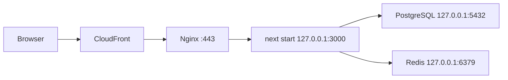

# EC2 server setup (Phase 0)

How the Node.js app, PostgreSQL, and Redis run on the existing EC2 instance. Commands assume Ubuntu with systemd; adjust package names for Amazon Linux.



## 1. App user and layout

```bash
sudo useradd --system --no-create-home --home-dir /srv/power-meals --shell /usr/sbin/nologin powermeals
sudo install -d -o powermeals -g powermeals /srv/power-meals
sudo -u powermeals git clone <repo-url> /srv/power-meals
```

Node 22.9 or newer is required (`.node-version` pins 22; `db:seed` relies on `--env-file-if-exists`).

## 2. Secrets

```bash
sudo -u powermeals cp /srv/power-meals/.env.example /srv/power-meals/.env
sudo -u powermeals nano /srv/power-meals/.env
sudo chmod 600 /srv/power-meals/.env
```

The systemd unit loads this file through `EnvironmentFile`. Nothing secret lives in the repo or in the unit file.

`PASSWORD_PEPPER` (`openssl rand -base64 32`) is mixed into every password hash. If it is lost or changed, nobody can log in, so back it up alongside the database credentials.

## 3. PostgreSQL (localhost only)

The data directory must sit on an **encrypted EBS volume** (enable encryption when creating the volume; it cannot be toggled on an existing one).

`postgresql.conf`:

```
listen_addresses = 'localhost'
password_encryption = scram-sha-256
```

`pg_hba.conf` (remove any `0.0.0.0/0` or `::/0` lines):

```
local   all          postgres                    peer
host    powermeals   powermeals   127.0.0.1/32   scram-sha-256
host    powermeals   powermeals   ::1/128        scram-sha-256
```

```bash
sudo -u postgres psql -c "CREATE ROLE powermeals LOGIN PASSWORD '<strong-password>';"
sudo -u postgres psql -c "CREATE DATABASE powermeals OWNER powermeals;"
sudo systemctl restart postgresql
```

`gen_random_uuid()` is built in from PostgreSQL 13, so no extensions are needed.

## 4. Redis (localhost only, password, bounded memory)

`/etc/redis/redis.conf`:

```
bind 127.0.0.1 -::1
protected-mode yes
port 6379
requirepass <strong-password>
maxmemory 256mb
maxmemory-policy volatile-lru
```

`volatile-lru` only evicts keys that carry a TTL. Sessions, guest carts, and rate-limit counters all have TTLs, so under memory pressure Redis drops the least recently used of those instead of failing writes on unrelated keys.

```bash
sudo systemctl restart redis-server
redis-cli -a '<strong-password>' ping   # PONG
```

## 5. Security groups

Inbound rules on the instance:

| Port | Source | Purpose |
|------|--------|---------|
| 443 | CloudFront origin-facing prefix list (`com.amazonaws.global.cloudfront.origin-facing`) | HTTPS from CloudFront |
| 80 | Same prefix list | Redirect / ACME challenge |
| 22 | Admin IP only (or SSM Session Manager, no rule) | SSH |

No rules for 5432, 6379, or 3000. Both data stores also bind to localhost, so a misconfigured security group alone does not expose them.

## 6. Deploy

```bash
cd /srv/power-meals
sudo -u powermeals git pull
sudo -u powermeals npm ci
sudo -u powermeals npm run db:migrate
sudo -u powermeals npm run db:seed        # idempotent upsert of catalog, zones, pickup points, kitchens
sudo -u powermeals npm run build
sudo systemctl restart power-meals
```

First install of the service:

```bash
sudo cp deploy/systemd/power-meals.service /etc/systemd/system/
sudo systemctl daemon-reload
sudo systemctl enable --now power-meals
journalctl -u power-meals -f
```

`db:seed` is safe to re-run: it upserts by slug and never deletes rows. Zone and pickup-point routing to kitchens can be changed directly in the database; re-seeding does not overwrite `kitchen_facility_id` on existing zones or points.

### Kitchen staff accounts

Staff can't self-register. Create each account for one kitchen (`zona-rio`, `otay`, `plaza-monarca`, `rio-tijuana-3ra-etapa`):

```bash
cd /srv/power-meals
read -rs STAFF_PASSWORD && export STAFF_PASSWORD   # typed without echo, kept out of shell history
sudo -u powermeals --preserve-env=STAFF_PASSWORD npm run user:create-staff -- \
  --email cocina.otay@powermeals.mx --name "Cocina Otay" --facility otay
unset STAFF_PASSWORD
```

Staff log in at `/ingresar` and land on `/kitchen/dashboard`, which only shows their own kitchen.

## 7. Nginx

Merge [`deploy/nginx/powermeals.conf`](../deploy/nginx/powermeals.conf) into the existing config. Uncomment the `set_real_ip_from` block with CloudFront's origin-facing ranges; without it every rate limit applies per CloudFront edge rather than per client.

Security headers (CSP, HSTS, frame denial) are sent by Next.js from [`next.config.ts`](../next.config.ts), so Nginx does not need to add them.

## 8. Health check

```bash
curl -s http://127.0.0.1:3000/api/health
# {"status":"ok","checks":{"database":"ok","redis":"ok"}}
```

Returns `503` with `"degraded"` and the failing check when PostgreSQL or Redis is unreachable. Nginx only allows it from localhost by default.

## 9. CloudFront behaviors

| Path pattern | Cache policy | Notes |
|--------------|--------------|-------|
| `/_next/static/*` | CachingOptimized | Hashed filenames, immutable |
| `/images/*`, `/maplibre/*`, `/logo.svg` | CachingOptimized | Public assets |
| `/api/*` | CachingDisabled | Forward all headers, cookies, query strings |
| `/kitchen/*`, `/cuenta*`, `/historial*`, `/ingresar*`, `/registro*`, `/pedido*` | CachingDisabled | Session-bound pages |
| Default (`*`) | UseOriginCacheControlHeaders | Static marketing pages send `public` headers; dynamic ones send `private, no-store` |

Forward the session cookie only on the uncached behaviors so cached responses never vary by user.

## Cloudflare static deploy

`main` still builds the static export for Cloudflare Workers. The `v2` branch removes `output: "export"` and cannot produce `out/`, so do not run `wrangler deploy` from it. Cloudflare is retired in Phase 5 once EC2 is stable (see [PLAN.md](../PLAN.md)).
